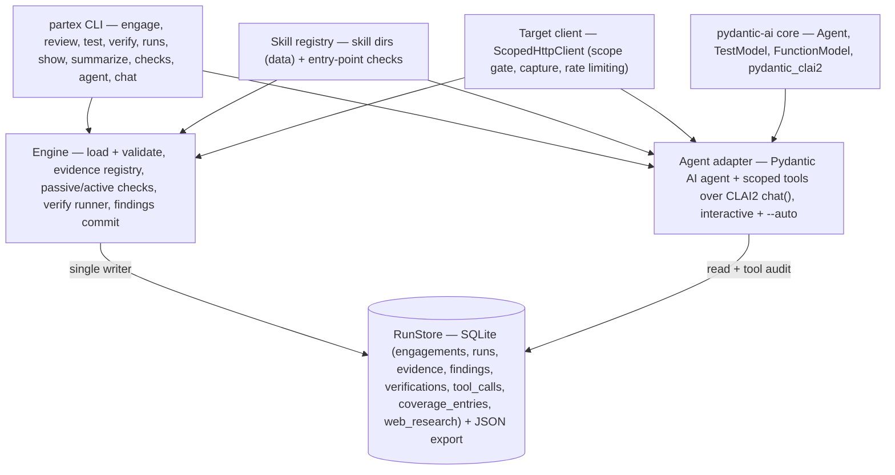
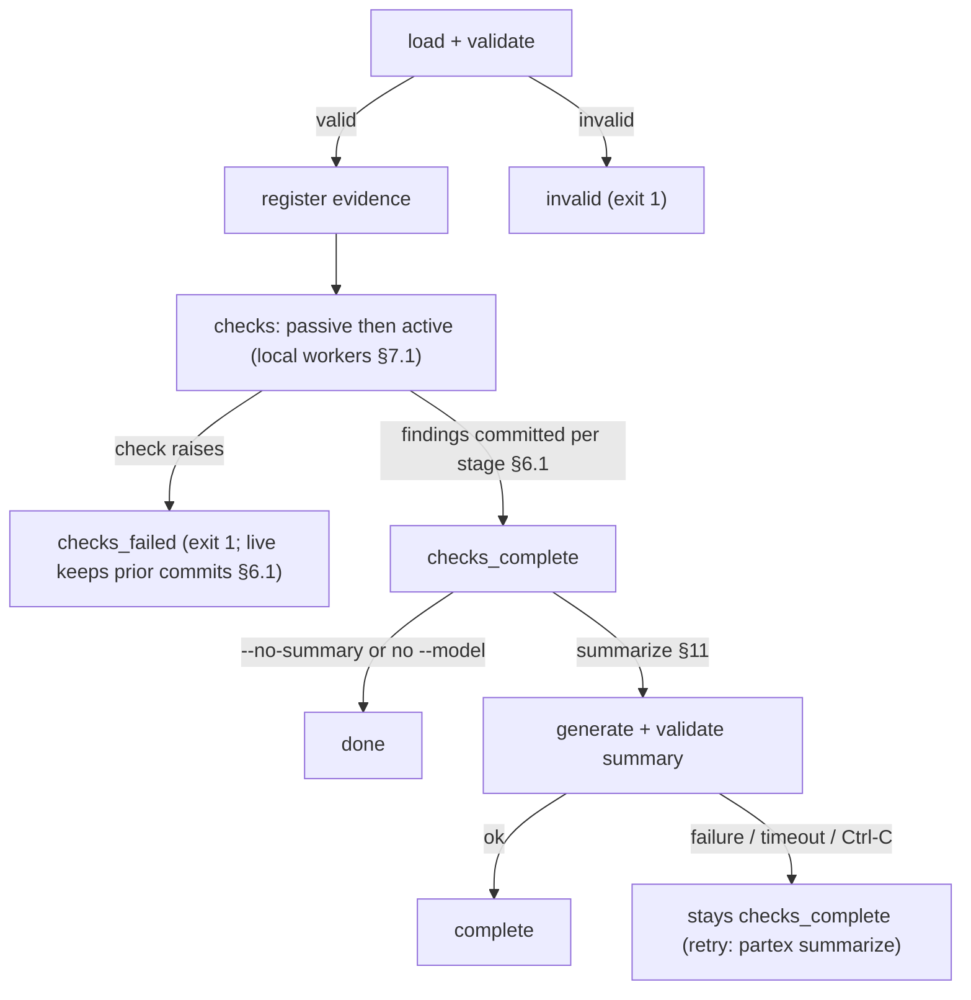

# Greenfield Python framework for web application security testing

> Status: implementation in progress. The milestone and validation status in §15 distinguishes
> landed components from gates that remain open. **Revision note:** this revision replaces the earlier
> offline-only defensive-review scope with the full offensive scope of the original Artex
> lineage (authorized live-target testing, active checks, exploit verification, agent loops).
> What is preserved from the earlier sketch: no dependency on any Artex fork, skills stay
> outside the engine as data, findings are always evidence-backed and survive every failure
> mode, and the validation suite runs credential-free against local fixture targets.

See [RUNTIME.md](RUNTIME.md) for execution environments, access boundaries, and state lifetime.

## 1. Scope

Build a Python package, `partex` (import name `partex`), using locked PyPI releases of the
Pydantic AI and CLAI2 stack. Use Artex as a reference for workflow patterns — engagement
lifecycle, evidence-linked findings, exploit verification, skill playbooks, and reporting — and
for its skill content format. The package has no dependency on any Artex fork, service, schema,
or runtime.

### Goals

- **Authorized offensive testing of live web applications**: reconnaissance, active probing,
  and exploit verification against targets declared in an engagement file, inside a hard scope
  boundary enforced in code.
- **Evidence-backed findings**: every persisted finding links to captured request/response
  evidence. A finding the engine cannot tie to evidence is never persisted. Verified findings
  additionally carry a replayable verification record.
- **Findings that always survive**: persisted before any model-backed stage, readable after a
  failed, timed-out, or cancelled summary, verification, agent loop, or chat turn. Evidence is
  persisted **at capture time** (each capture commits immediately), so even a mid-run crash
  discards nothing already sent or received.
- **Two execution modes**:
  - *Passive*: deterministic review of offline evidence bundles (imported captures, config
    excerpts) or of traffic captured during earlier active runs. Passive findings are a pure
    function of (evidence, selected checks, engine version); the model is never in the passive
    findings path.
  - *Active*: scoped live testing — active checks send probes through the target client, and
    verification replays minimal PoC requests to confirm exploitability. Active findings carry
    full evidence snapshots so they are auditable and replayable even though target state may
    drift. Live evidence commits at capture time (see §6.1), so a crash mid-run never loses
    exchanges already paid for in requests.
- **An agent layer** over the run, built on the locked pydantic-ai agent stack: an interactive
  operator-driven mode embedded in the CLAI2 `chat()` terminal client, and a `--auto`
  autonomous loop (planner → tool calls → evidence-gated findings) that drives the same agent
  directly via `agent.run()`/`agent.iter()` — not through `chat()`, which is a TUI-only
  conversation API returning `None`. Both are confined to the engagement scope by the tool
  layer, not by the prompt.

### Non-goals (v1)

- No multi-user, no server, no web UI beyond the terminal. One operator, one machine.
- No MITM proxy: live evidence comes from the package's own scoped HTTP client, from the
  browser capture harness's network-event recording (M7), or from operator-exported HAR files
  (M3) — never from intercepting third-party or external tools' traffic (see §17.5).
- No exploit payload development beyond verification: verification proves a finding with the
  minimal request set (an error triggered, a boundary crossed, a version-confirmed CVE
  signature); it does not build shells, persistence, or post-exploitation tooling (see §17).
- No write-back to findings from chat or the agent loop: the model proposes, the engine
  validates evidence and disposes (§9).
- No diffing between runs (see §17).

### Design evolution (superseded assumptions)

Several initial assumptions in earlier drafts have been explicitly amended as implementation progressed:

1. **PyPI-locked stack instead of sibling checkouts (#13, #16):** `pydantic-*` and `pydantic-monty*`
   resolve from PyPI via hash-pinned `uv.lock` with a 2-day `exclude-newer` cool-off, never
   `[tool.uv.sources]` path overrides.
2. **Reviewed runtime addition for JS analysis (#69):** Relaxed the "zero new PyPI runtime deps in
   M0–M6" baseline to add `tree-sitter` + `tree-sitter-javascript` for deterministic, non-executing
   JavaScript AST analysis (`DEPS.md` §8.9).
3. **Model-free CLI by default:** `partex review` and `partex test` run model-free by default without
   needing a `--no-summary` flag; model summarization (`partex summarize`, M4) is a separate step.
4. **Full-body artifacts & opt-in TLS relaxation (#69, #71):** Added `ArtifactEvidence`
   (`kind='artifact'`, mode-`0600` files in `<db>.artifacts/`, `file_path` excluded from `ev_*` IDs)
   for assets over the 256 KB inline cap, and opt-in `--insecure` / `tls.verify=false` recorded on
   the run and evidence.
5. **Async `ActiveCheck.probe` & `HttpEvidence`-returning `TargetClient` (#39, #44):** Updated the §10
   check contract so probes await `TargetClient.request(...) -> HttpEvidence` and `verify_recipe`
   receives `(finding, evidence)`.
6. **State-changing and multi-protocol probing policy (#119):** Added engagement
   `scope.allowed_methods` and `scope.max_write_requests`, mapped `ws`/`wss` onto the §4.2 scope
   rules, and defined one operator-approval primitive shared by non-safe HTTP methods, websocket
   frame sends, gRPC invocation, and write-bearing verify recipes — settling the safety model
   #65, #116, and #117 were each blocked on. Passive checks and their determinism guarantees are
   unchanged; this declares how writes and new protocols enter under the same controls.

### Constraints

- Dependent `pydantic-*` packages (`pydantic-ai-slim`, `pydantic-ai-harness`, `pydantic-clai2`)
  resolve from PyPI, pinned with hashes in `uv.lock` and installed with `uv sync --frozen`
  (issue #13). Given the November 2026 prebuilt-image backdoor in the Artex lineage (see
  `README.md`), the lockfile hashes and the §13.1 check are the supply-chain control, and the
  package publishes no prebuilt artifacts; every other dependency (`httpx2`, `rich`,
  `prompt-toolkit`, etc.) resolves from the same lockfile.
- **Authorization is a hard gate, not a convention.** Every live run requires an engagement
  file containing an explicit authorization attestation, and every outbound request passes a
  scope check in the target client (§4.2). There is no code path that sends traffic without
  both. This mirrors the standing rule of every shipped Artex skill ("authorized engagements
  only") and bbot's program-policy gates, but enforced in code.
- **Secrets are first-class.** Live testing needs real credentials; they enter via engagement
  credential references (environment variables), are marked secret at capture, and are redacted
  in exports, model-facing tool returns, and telemetry by default (§5, §9, §11.1).
- Model-backed stages (summary, agent, chat) are opt-in and injectable with test models. The
  validation suite never needs credentials or a network beyond localhost (§13).
- Skill content is data (Markdown), including offensive playbooks. It is never executed,
  imported, or interpreted by the engine. Check code loads only from installed distributions
  via entry points (§10).
- Evidence bytes are attacker-controlled input wherever they reach a prompt: they are framed
  as untrusted data, and no model-facing tool can mutate run state (§9).

## 2. Architecture



Layer rules:

| Layer | Owns | Never does |
|---|---|---|
| Engine | validation, evidence registration, check execution, verification orchestration, persistence, export | import or execute skill content; build prompts |
| Registry | discover checks (entry points) and skills (directories), join by `check_id` | contain testing logic |
| Target client | scope enforcement, request execution, evidence capture, rate limiting | decide what to request; bypass scope for any caller |
| Browser harness (M7) | browser-driven capture and probing into `RunStore`; role contexts; route-interception scope gate | intercept network traffic (MITM); serve as the client for checks or verification (they stay on the scoped client) |
| Agent adapter | agent construction, scoped tools, CLAI2 wiring, `--auto` loop | mutate run state; construct raw HTTP outside the scoped tool |
| Checks (passive) | deterministic review logic over validated evidence | I/O, network, model calls, storage access |
| Checks (active) | probe logic expressed through the target client | construct their own HTTP stack; write storage |

The scope gate lives **only** in the target client, and the target client is the **only**
module that opens sockets directly. The M7 browser capture harness (§15) is the sanctioned
exception: it attaches to (or, for credential-free discovery and CI, launches) a browser
process that opens its own sockets, and its scope is enforced at the automation layer's
route hook — out-of-scope navigations and requests are aborted before send and recorded on
the run — never by prompt. Checks, the verification runner, and the agent's HTTP tool all
receive a
client handle scoped to one engagement; a request that fails scope is a hard error before it
reaches the network.

## 3. Package layout

The package lives at the **root of this repository** (not inside the `pydantic-ai` uv
workspace; see §3.1). The repository root is the uv project; `skills/` and `fixtures/` stay at
the root where they already are:

```text
<repo root>/
  pyproject.toml
  README.md  PLAN.md  RUNTIME.md  ...   # planning docs stay at the root
  src/partex/
    __init__.py            # version, public re-exports
    __main__.py            # console entry point
    cli.py                 # argparse surface (engage/review/test/verify/runs/show/summarize/checks/agent/chat)
    models.py              # Engagement, Scope, ReviewBundle, Evidence, HttpExchange,
                           # ConfigExcerpt, Finding, Verification, ReviewSummary
    bundle.py              # bundle load + validation (passive mode input)
    engagement.py          # engagement load + validation, authorization attestation
    scope.py               # Scope model + matching (hosts, path prefixes, exclusions, ports)
    ids.py                 # content-hash IDs, canonical JSON encoding (sorted keys,
                           #   ensure_ascii, compact separators)
    models_config.py       # role-based ModelRouter, fallback/retry/concurrency wrappers,
                           #   per-role ModelSettings (thinking, cache, timeouts)
    errors.py              # PartexError, ValidationFailed (rule code), ScopeViolation, BudgetExhausted
    registry.py            # check/skill discovery and join
    checks/
      __init__.py          # PassiveCheck / ActiveCheck / TargetClient protocols, FindingDraft,
                           #   VerificationRecipe, draft validation
      builtin.py           # re-exports the built-in checks below (entry-point targets)
      header_security.py   # header-security (passive)
      version_disclosure.py  # version-disclosure (active probe + verify_recipe)
    har.py                 # import-har: HAR file -> passive bundle, scope-filtered (M3)
    nmap.py                # nmap -oX scan output -> authorized-URL-list entries (skip report + sha256; #215)
    browser.py             # M7 browser capture harness (Playwright; sanctioned socket exception)
    target.py              # scoped HTTP client (the only engine socket-opening module), capture
                           #   (httpx2, follow_redirects=False, pinned resolver + SNI)
    verify.py              # verification runner: minimal PoC replay, verdict, evidence
    engine.py              # run lifecycle, ordered execution, failure policy, single writer
    storage.py             # SQLite RunStore, schema v5, version gate
    export.py              # JSON export with default secret redaction
    summarize.py           # model-backed ReviewSummary generation + reference validation
    agent_adapter/         # the only package that imports pydantic_clai2
      __init__.py          # AgentDeps, build helpers, public entry points
      tools.py             # shared run-scoped read tools, redaction + untrusted-data envelope
      reviewer.py          # partex_reviewer_agent (chat <run-id>), CodeMode wiring
      tester.py            # partex_tester_agent, scoped live tools, audit hooks
      auto.py              # --auto loop via agent.run()/agent.iter(), StepPersistence
  skills/                  # built-in skills (data); shipped in the wheel as partex/skills/
    header-review/
      SKILL.md             # frontmatter: name, description, modes, checks: [header-security]
      reference/*.md
    version-disclosure/
      SKILL.md
    api-inventory/  authorization-testing/  auth-session-controls/   # staged (§10)
  fixtures/
    bundles/valid/         # valid passive fixture bundle
    bundles/malformed/     # one dir per failure mode (§13)
    target_app/            # deliberately vulnerable fixture app (stdlib http.server, localhost)
    skills/banner-leak/    # fixture skill
  tests/
    conftest.py            # model-call blocking, non-localhost network blocking, tmp stores
    test_bundle.py  test_engagement.py  test_scope.py  test_ids.py  test_registry.py
    test_target.py         # scope gate: in-scope allowed, out-of-scope refused, redirect handling
    test_verify.py         # verdicts, replay, evidence capture against fixture app
    test_engine.py  test_storage.py  test_export.py  test_summarize.py
    test_agent_tester.py   # tools scoped to engagement+run, out-of-scope tool calls refused,
                           #   tool_calls audit rows recorded
    test_agent_reviewer.py # chat() integration: TestModel, Console(StringIO), cancellation
```

Built-in skills stay at `skills/` in the source tree (one location for drafting and shipping);
the build backend force-includes them into the wheel at `partex/skills/` and the registry
loads them through `importlib.resources`. They remain data: nothing under `skills/` is imported
or executed. `fixtures/` and `tests/` are not shipped.

The module splits above (`errors.py`, one module per built-in check, and
`agent_adapter/` as a package) exist so independent work items own disjoint files; the
architectural boundaries in §2 are unchanged (`agent_adapter` is still the only importer of
`pydantic_clai2`, `target.py` still the only engine socket-opening module, with the M7
`browser.py` harness as the one sanctioned exception described in §2).

### 3.1 Environment and dependencies

- Python `>= 3.14` (`requires-python = ">=3.14"`), deliberately above the upstream packages' `>=3.11`
  floor so partex can use current syntax and semantics freely: PEP 695 `type` aliases and
  generic class syntax, and PEP 649 deferred annotations (so `from __future__ import
  annotations` is never needed). Monty's PyO3 0.30 supports 3.14. Managed with `uv`.
- A standalone uv project with no `[tool.uv.sources]` or `[tool.uv.overrides]`: direct dependencies
  carry minimum-version bounds (`pydantic-ai-harness[repair-tool-arguments]` for `json-repair`),
  and `pydantic-monty` with its exact-pinned client and runtime arrives transitively through
  `pydantic-clai2` as prebuilt wheels (no Rust/Maturin build). CLAI2 requires
  `pydantic-monty>=1.0.0,<2` even when Code Mode is disabled. Upgrading the stack is an explicit,
  reviewed `uv.lock` change (`DEPS.md` §4.1).
- Other runtime dependencies: the target client uses **httpx2** (decided, `DEPS.md` §8.1: the
  HTTP library the `pydantic-ai-slim`/`pydantic-ai-harness` stack builds on throughout;
  pinned via the lockfile). The DNS-rebinding guard and correct SNI + hostname cert
  verification on a pre-resolved address are security-critical; `follow_redirects=False` and
  a custom transport provide them without hand-rolling sockets/`ssl`. M0 runs the
  API-equivalence gate on that custom-transport surface (§4.2); on failure the fallback is
  `httpx` 0.28.x (present via `pydantic-clai2` until its own httpx2 migration). No other
  HTTP library is introduced; anything beyond the locked set is a reviewed `uv.lock` addition. Dev dependencies: `pytest`, `anyio`, `ruff`, `pyright`,
  `inline-snapshot`, plus `coverage`/`pytest-cov` (the 100% branch target) and the
  `capfire` fixture for Logfire span assertions. The M0–M6 milestones add **no other PyPI
  runtime dependency** (`DEPS.md` documents the per-module decisions: minimal OpenAPI
  resolver as check code, stdlib-only JWT crafting, hand-rolled RFC 6265 cookie parsing);
  the M7 browser harness adds lockfile-pinned `playwright` (fallback: `websockets` for
  capture-only raw CDP) as the single scheduled post-M6 addition.
- Tooling conventions mirror the checkout: ruff with single quotes and 120-column lines, pyright
  strict, `anyio_mode = "auto"`, coverage target 100% branch with narrow pragmas on true I/O
  edges.

## 4. Inputs: engagements and bundles

The package has two input shapes. An **engagement** declares a live target and the authority to
test it; a **bundle** is offline evidence for passive review. One run consumes exactly one
input; an engagement run may later export a bundle (§7) for passive re-review.

### 4.1 Engagement format

```text
engagement/
  engagement.json      # manifest
  credentials.env      # optional; referenced by name, never inlined into the manifest
```

`engagement.json`:

```json
{
  "schema_version": 1,
  "target": {"name": "example-app", "base_url": "https://staging.example.test"},
  "scope": {
    "hosts": ["staging.example.test"],
    "path_prefixes": ["/"],
    "exclusions": ["/admin/shutdown", "/logout"],
    "ports": [443],
    "max_rps": 5,
    "max_requests": 2000,
    "allowed_methods": ["GET", "HEAD", "OPTIONS", "POST"],
    "max_write_requests": 50
  },
  "authorization": {
    "attestation": "Written authorization from Example Corp, ref SOW-2026-114, expires 2026-12-31.",
    "operator": "j.operator"
  },
  "credentials": {"session": "PARTEX_CRED_SESSION"},
  "roles": {"owner": "PARTEX_CRED_OWNER", "guest": "PARTEX_CRED_GUEST"},
  "suggested_checks": ["header-security", "version-disclosure"]
}
```

Validation rules (all enforced before any network call, before any model call, before any run
row is finalized):

| # | Rule | Failure mode |
|---|---|---|
| E1 | manifest parses, `schema_version` is exactly `1` | `engagement-version` |
| E2 | `authorization.attestation` is present and non-empty; the CLI additionally requires `--authorized` on every live command, and the stored run records both | `unauthorized` |
| E3 | scope is non-empty: at least one host; every host parses; `exclusions` are within `path_prefixes`; `max_rps` is positive with a hard ceiling (64 rps); `max_requests` is a non-negative budget with a 100k ceiling, where `0` means unlimited (the rps ceiling still bounds the send rate); `allowed_methods` defaults to `GET, HEAD, OPTIONS`, must include `GET`, and entries come from `{GET, HEAD, OPTIONS, POST, PUT, PATCH, DELETE}` (`CONNECT` and `TRACE` are forbidden); `max_write_requests` defaults to 0 (no state-changing traffic) with a hard ceiling of 1,000; listing a non-safe method with `max_write_requests == 0` (or `max_write_requests > 0` with safe-only methods) is rejected | `scope-invalid` |
| E4 | `credentials` values are environment variable **names** matching `PARTEX_[A-Z0-9_]+` (the namespace keeps an engagement file from naming an unrelated secret such as `GITHUB_TOKEN`); inline values are rejected. Referenced variables must be set at run start | `credential-invalid` / `credential-missing` |
| E5 | `base_url` host must be inside `scope.hosts` | `scope-invalid` |
| E6 | `suggested_checks` entries that are not registered are dropped with a warning | - |
| E7 | `roles` is optional; keys are role names, values are environment variable **names** matching `PARTEX_[A-Z0-9_]+`, validated exactly like `credentials` (E4), each role a distinct variable; referenced variables must be set at run start | `credential-invalid` / `credential-missing` |

`roles` maps role names to credential variables for multi-identity testing: active
authorization checks and their verification recipes replay the same operation under two roles
to prove a boundary is real (never by trusting a single response). Each role binds its own
client handle through the same scope gate (§4.2), and its credential fields are marked
`secret_fields` at capture like any other (§5).

### 4.2 Scope enforcement (target client)

Every outbound request — from an active check, the verification runner, or the agent's HTTP
tool — is validated immediately before send:

1. **Scheme and port**: `http`/`https`, plus `ws`/`wss` (#119) mapped onto the matching cleartext/TLS
   rules (`ws` follows the `http` rules, `wss` the `https` rules: same host, port, path-prefix,
   exclusion, DNS-pin and TLS checks, default ports 80/443); the effective port must be in
   `scope.ports`.
2. **Host**: exact match against `scope.hosts` (no suffix matching; `evil-example.test` does
   not match `example.test`). DNS rebinding guard: resolution happens once per run through a
   pinned resolver result, and the client connects to the resolved address while keeping the
   original `Host` header and SNI (and cert verification against the original hostname, not the
   IP) — via httpx2's transport, never hand-rolled sockets.
3. **Path**: must start with an allowed `path_prefix` and match no `exclusions` prefix
   (exclusions win).
   **Authorized URL list (#121).** An optional `scope.urls` narrows rule 3 to an exact allowlist: a
   request must also match an entry on host, effective port, and every path interpretation (exact
   path, or a path prefix for an entry ending `/*`); the query string is not compared. An entry without an
   explicit port covers both 80 and 443 (either scheme); an explicit `:port` pins that port.
   Empty (the default) means no URL-level restriction. It is set by `--urls-file` (`partex test`,
   `partex agent`, `partex.sh -u`): one URL per line, `#` comments, an empty file or a bad line is
   refused as `scope-invalid` before any socket, the listed hosts and ports are added to
   `scope.hosts`/`scope.ports`, and `target.base_url` must be listed. Exclusions still win, and unlisted
   probes (such as a check's `/robots.txt`) are refused by the scope gate rather than failing the run. `--recursive` (requires `--urls-file`; `partex.sh --recursive`) turns every entry into a `/*` prefix,
   dropping any query or fragment, so `http://foo/` allows every path on that host and port.
   A refusal carries its rule (`host`, `port`, `path`, `url-list`) so the model's advice to the operator fits it;
   with a list active, the operator's `/scope add <url>` (`…/*` for a prefix) adds a URL after `/scope confirm`, and a bare
   host is refused with that hint.
   **nmap import (#215).** `partex nmap <scan.xml>…` converts `nmap -oX` output into URL-list entries —
   `scheme://host:port/*`, the scanned IP (or, with `--use-hostnames`, the PTR name) — plus a skip report, and
   never touches `scope.hosts`/`scope.ports` directly (an import of `a:443` + `b:8080` must not also authorize
   `a:8080`). Deterministic parse rules: `<host>` up, TCP only, `state="open"` only; scheme from the `-sV`
   service name (HTTP-family names import; `tunnel="ssl"` promotes an HTTP service to https but never makes a
   non-HTTP one a target), else the {80, 443} defaults, else a skip note. Entity/external-DTD declarations are
   refused (XXE / billion-laughs guard). `partex.sh -N/--nmap-file` converts and feeds the result to the
   `--urls-file` path (first imported entry = the baseline target, the attestation prompt names the import
   size); `/scope nmap <scan.xml>` stages the same batch in the live session and `/scope confirm` applies it
   as one `scope_amend` audit row recording the scan path and its sha256 (the batch keeps
   `target.base_url` covered; a run's `scope_snapshot` pins the exact entries).
   **Initial probe pass.** A session with an active URL list (however it got there) opens with one
   `GET` per listed entry — safe method, same scope gate and budget, captured at capture time —
   before the checks run, so passive review covers banner and error-page evidence from every listed
   host:port, not just the baseline target (whose own capture counts for it). A dead host is counted
   and probed past, never a run failure; budget exhaustion ends the pass cleanly. Startup only: an
   operator-confirmed `/scope nmap` widens scope but probes nothing (the operator asks in chat).
   `partex.sh -N` raises `--max-requests` to cover the import (capped at the E3 ceiling).
4. **Redirects**: never followed automatically; a redirect response is captured as evidence,
   and the new location is re-validated from rule 1 if the caller chooses to follow it.
5. **Budgets**: a token-bucket limiter enforces `max_rps`; a run-level counter enforces
   `max_requests` (`0` = unlimited). Exhaustion ends active work cleanly (`checks_complete` with what is
   committed), it is not an error.

**Operator exports (`/report`, `/secrets`, #88).** Two more operator-only slash commands live in the
same partex CLAI2 plugin as `/scope`; the model has no tool for either. `/report [path]` writes a
Markdown report of the run from the redacted export payload (default
`<db>.exports/<run_id>.report.md`). `/secrets [path]` writes the values partex redacts everywhere
else, JavaScript secret candidates re-extracted from stored artifacts and the `secret_fields` of
captured HTTP evidence, to a `0600` file in a `0700` directory. Both print only the path and counts,
never a value, so nothing secret reaches the transcript or the model's context.
`*.db.artifacts/` and `*.db.exports/` are gitignored.

**Skills as deferred capabilities (#59).** `chat` and `agent` offer each discovered skill as a
`Capability(defer_loading=True)`: the model sees only the skill's one-line description in a catalog and
calls `load_capability` to pull the playbook (`SKILL.md` body plus `reference/*.md`, capped) into context
on demand. Playbooks whose checks are not installed (unfinished drafts) are left out of the catalog;
`--skill-dir` adds extra roots. Skills stay data, read as Markdown and never imported or executed, and
findings are still recorded only by checks.

**Live passive checks (#51).** `partex test` and `partex agent` accept passive and active check IDs.
After the baseline capture and every active probe, the selected passive checks review all exchanges
the run captured, so a live run no longer reports zero findings merely because the passive half
never ran. Findings commit per check in selection order (active checks first, then passive); a
passive check that does not apply is listed in `skipped_checks`, and one that raises ends the run
`checks_failed` with earlier findings and all evidence kept. Passive checks still run after the
request budget ends active work. Default selection for `test`: every installed passive check plus
`version-disclosure`; `--all` runs every installed check.

**Invalid TLS certificates (operator opt-in, #71).** The client verifies certificates against the
original hostname by default. An operator can accept invalid ones (self-signed, private CA,
expired, hostname mismatch) with the engagement's `tls: {"verify": false}` (optionally
`insecure_hosts`, a subset of `scope.hosts`; empty means every in-scope host), `partex test|agent
--insecure`, or `partex.sh -k`. Only the target client relaxes verification, per host through a
second transport, so model-provider traffic and other hosts stay strict; the scope gate, DNS pin,
SNI and Host header are unchanged. The run records a `tls_verify_disabled` audit row and prints a
warning; each exchange made unverified carries `tls_verified: false` (omitted when true, and not
part of the evidence ID); a verification replay reuses the original exchange's setting. The model
has no tool for it. Reporting the certificate itself as a finding is a follow-up. With no
`insecure_hosts`, `-k` / `verify: false` also covers hosts the operator adds later with `/scope add`;
with `insecure_hosts` listed, added hosts stay verified. `/scope add` and `/scope confirm` say when an
added host will not be verified, and the `scope_amend` audit row records `tls_verified` per added host (#101).

**User-Agent (#135).** Every request the target client sends carries one User-Agent per run: the
engagement's `http: {"user_agent": "..."}`, overridden by `partex test|agent|verify --user-agent`,
or `partex/<engine version>` when neither is set, never the HTTP library's own default (that would
disclose the tool stack). It is a client-level default header, so every send path inherits it, and
a request's own `User-Agent` header still wins. A set value must be one line of printable ASCII, not
blank, at most 512 characters; anything else fails engagement load (or the `--user-agent` gate)
with `http-invalid` before any socket. It is never a secret: it is captured in evidence and exported
like any other request header. A verification replay presents the original request's User-Agent
unless `verify --user-agent` is given. No rotation: one consistent value keeps evidence stable.

**Live scope extension (operator only).** In a live `agent` session the operator can add a host
and port with the CLAI2 slash command `/scope add <host[:port]|url>`, which only *stages* the
change and shows the exact additions (ports apply to every host in scope); `/scope confirm`
applies it, `/scope cancel` drops it. Slash commands are handled by the terminal shell and never
reach the model, and the model has no scope tool, so a chat message cannot widen scope. The scope
only grows (`ScopedHttpClient.set_scope` rejects any removal, budget, or method-policy change and
re-runs E3), each amendment is recorded on the run as a `scope_amend` tool call, and
`runs.scope_snapshot` holds the current scope. The command is a small partex-owned CLAI2 plugin;
the session uses a private settings store so the operator's saved and drop-in CLAI2 plugins stay
out (#64).

**State-changing actions (operator approval, #119).** Safe HTTP methods (`GET`, `HEAD`, `OPTIONS`),
listen-only websocket capture (#116), and read-only gRPC `ServerReflection` discovery (`grpc_list`,
#117 — its HTTP/2 `POST` framing neither requires `POST` in `allowed_methods` nor consumes
`max_write_requests`, while still passing `check_url` on `/grpc.reflection...` and `max_requests` /
`max_rps`) send without approval ceremony. Every other engine action that can change target state —
an HTTP request with a non-safe method, a websocket frame send, a gRPC method invocation
(`grpc_call`), or a verification recipe containing one — passes one shared approval gate before send:

1. **Pre-prompt authorization, scope, and budget checks.** Before any prompt is shown, the action
   must: (a) be authorized by `scope.allowed_methods` (`grpc_call` requires `POST`; a websocket
   frame send requires at least one non-safe method listed), (b) pass the full URL scope gate
   (`check_url` rules 1–3: scheme, port, host, `path_prefixes`, and `exclusions` — excluded or
   out-of-scope targets are never approvable and fail before a prompt exists), and (c) have
   remaining room in both `max_requests` and `max_write_requests`. Approval can never unlock a
   method or target the engagement does not authorize: the engagement is the authorization, the
   prompt is per-action consent.
2. **Operator consent and keying.** The operator is shown the exact action (method, full URL or
   `service/method`, header names, a redacted body summary) and chooses **approve** (that exact
   `method + full URL (scheme, host, port, path, query) + body`), **approve for this session**
   (`method + scheme + host + port + exact path`, any body — never a wildcard), or **deny**
   (optionally with a typed reason sent back to the model). The model can never answer its own
   prompt, and chat text never counts as approval; with no interactive operator (`--auto`,
   `partex test`, or non-TTY `partex verify`) the action is denied and nothing is sent. In
   `partex verify`, an interactive TTY prompts under the run's stored `scope_snapshot`; a denied
   or non-interactive write replay records verdict `inconclusive` (leaving finding status
   unchanged, never `verification_failed`).
3. **Send-time enforcement and budgets.** An approved action still passes `ScopedHttpClient`'s
   send-time scope gate, rate limiter, and both budgets (`max_requests` plus the separate
   `max_write_requests` counter, persisted on the run as `write_requests_spent`), so approval
   never bypasses `target.py` and concurrent calls cannot overrun either budget. Write-budget
   exhaustion ends write work cleanly, like `max_requests`.
4. **Audit.** Every held, approved, and denied decision is recorded on the run in `tool_calls`
   (action, method, URL, decision, reason) with secret values redacted.

A scope violation raises `ScopeViolation` before any bytes hit the wire, is recorded on the
run, and — when triggered by the agent — is raised as a `ToolFailed` tool error so the model
sees the failure and adapts without burning its tool retry budget (§9). The client has no API
that skips validation; tests assert there is no escape hatch (§13.4).

### 4.3 Bundle format (passive input)

Unchanged from the earlier design, minus the mandatory redaction rule:

```text
bundle/
  bundle.json            # manifest: schema_version, target, evidence_files, suggested_checks
  evidence/NNNN.json     # one HttpExchange or ConfigExcerpt record per file
```

Validation V1–V4 and V6 are as before (parse/version, per-file model validation, deterministic
dedup, size caps, unknown-check warnings). The old V5 (mandatory `<redacted>` markers) is
**dropped**: bundles exported from live runs legitimately contain credentials, which are
handled by the secret-marking and export-redaction machinery (§5) instead. Producers shipping
sanitized bundles may still use the `<redacted>` marker convention; it is accepted, not
required. Sanitization-before-sharing remains the producer's responsibility and is documented;
absence of evidence is not evidence of absence.

Evidence model (v1 kinds) is unchanged: `HttpExchange` (request/response with headers and
optional text bodies) and `ConfigExcerpt` (path, format, content). API contract documents
enter as `ConfigExcerpt` records with `format: openapi` and a `revision` (git SHA or version
string) alongside the path, so passive checks match concrete captured paths against the
contract's path templates and findings can cite the contract revision they were reviewed
against. Response capture sends
`Accept-Encoding: gzip` and transparently decodes `Content-Encoding` before storage; a decoded
body that is not valid UTF-8 (or is dominated by non-printable bytes) is captured as headers
plus a `body_refused` marker — binary bytes are never stored, and `Content-Type` is a hint, not
the arbiter.

## 5. Data contracts

All Pydantic models, `extra='forbid'`, validated at every boundary (input load, check output,
storage round-trip, export). Models avoid `from __future__ import annotations`, express
field-level bounds (E1–E5, non-empty `evidence_ids`) via `Annotated` + `Field` /
`StringConstraints` / `AfterValidator`, and use discriminated unions rather than nullable
sibling fields:

```python
Severity = Literal['info', 'low', 'medium', 'high', 'critical']

# (name, value) pairs in wire order: original casing and repeated headers (Set-Cookie) preserved.
# Look up with get_header()/get_all() (case-insensitive), never by position or dict key.
type Headers = list[tuple[str, str]]

class HttpRequest(BaseModel):
    method: str
    url: str                 # as requested (hostname, never the DNS-pinned address)
    headers: Headers
    body: str | None

class HttpResponse(BaseModel):
    status_code: int
    headers: Headers
    body: str | None

class HttpEvidence(BaseModel):
    id: str                  # "ev_" + sha256(canonical_json)[:16]  (§12)
    kind: Literal['http_exchange'] = 'http_exchange'
    source: str              # bundle-relative file; "capture:<run-seq>" (client);
                              # "capture:browser:<seq>" (harness, M7)
    http: HttpExchange
    secret_fields: list[str] # paths marked secret, redacted on export & model return: "$" then
                              # ".key" / "[n]" steps naming a string value, e.g.
                              # "$.http.request.headers[2][1]" (header 2's value) or "$.http.request.body";
                              # every path must resolve when the evidence is built (fail closed)

class ConfigEvidence(BaseModel):
    id: str                  # "ev_" + sha256(canonical_json)[:16]  (§12)
    kind: Literal['config_excerpt'] = 'config_excerpt'
    source: str              # bundle-relative file
    config: ConfigExcerpt
    secret_fields: list[str]

type Evidence = Annotated[HttpEvidence | ConfigEvidence | ArtifactEvidence, Field(discriminator='kind')]
# ArtifactEvidence (#69) stores metadata + sha256 + mode-0600 local file_path beside the DB for
# full-body assets (e.g. JS bundles > 256 KB); file_path is excluded from the canonical ev_ hash.

class Finding(BaseModel):
    id: str                  # "fn_" + sha256(check_id + '\0' + subject + '\0' + title + '\0' + sorted evidence_ids)[:16]
    check_id: str
    check_version: str
    severity: Severity
    subject: str             # what the finding is about: "cookie:sid", "header:strict-transport-security",
                             # "op:GET /users/{id}"; keeps apart findings sharing a title and evidence
    title: str
    description: str
    evidence_ids: Annotated[list[str], Field(min_length=1)]  # each must exist in the run's evidence
    remediation: str
    status: Literal['reported', 'verified', 'verification_failed']
    verification_id: str | None

class Verification(BaseModel):
    id: str                  # "vf_" + sha256(finding_id + '\0' + canonical request set)[:16]
    finding_id: str
    check_id: str
    requests: list[str]      # evidence IDs of the PoC exchanges (scoped, captured)
    verdict: Literal['confirmed', 'not_reproduced', 'inconclusive']
    replayable: bool         # True when verdict came from a deterministic replay recipe
    detail: str              # why the verdict holds: matched error, crossed boundary, etc.
    counterevidence: str     # opposing-case check (reachability, preconditions, scope, control)

class CoverageEntry(BaseModel):
    surface: str             # surface node key or normalized operation key (e.g. "GET /api/users/{id}")
    risk_area: str           # check_id or vulnerability class
    outcome: Literal['reported', 'no_issue_found', 'ruled_out', 'not_applicable', 'needs_follow_up']
    source: Literal['check_observed', 'agent_reported']
    evidence_ids: list[str]  # required for reported / no_issue_found
    reason: str              # required for ruled_out / not_applicable / needs_follow_up
    goal_attempts: int = 0   # conceptual-goal attempt counter for stuck detection

class ReviewSummary(BaseModel):
    narrative: str
    finding_ids: list[str]   # references validated against the saved run (§11)
```

Contract rules:

- A `Finding` is produced by a check as a **draft**; the engine validates drafts (known check
  ID, valid severity, evidence IDs resolve to the run's registered evidence, `evidence_ids`
  non-empty) and only then assigns final IDs and persists. A check can never write storage
  directly. The model is never a draft source: agent-proposed findings enter only as tool
  calls that invoke a registered check or the verification runner, never as free-form text
  (§9).
- New findings start `reported`. The verification runner transitions them to `verified` or
  `verification_failed` and attaches the `Verification` record; both transitions commit with
  the verification's evidence in the same transaction. Verification never deletes a finding.
- A check returning more than 1,000 drafts is rejected as a check failure (`checks_failed`).
- `ReviewSummary.finding_ids` must be a subset of the saved run's finding IDs; duplicates
  rejected; empty list with a non-empty run rejected.
- **Secrets**: at capture time the target client marks fields sourced from engagement
  credentials (matched header names and body tokens) in `secret_fields`. Storage holds
  cleartext (single-operator machine, deterministic `verify` replay needs it), while **both
  the export boundary and the model/telemetry boundary enforce redaction**: exports redact
  `secret_fields` to `<redacted>` by default (`--include-secrets` emits them and prints a
  warning), and agent/chat tools (`http_request`, `lookup_evidence`) always return redacted
  `Evidence` so cleartext credentials never leak into LLM provider requests, CLAI2 transcripts,
  or OpenTelemetry spans. Browser captures (M7) blanket-mark `Cookie`/`Authorization`
  headers — the browser holds sessions partex never provisioned — and mark `Set-Cookie`
  **value-only**, so cookie attributes stay visible to `session-cookie-config` and survive
  redacted export-bundle round-trips (`DEPS.md` §8.5).
- Models round-trip: storage writes serialized models and re-validates on read (via
  `TypeAdapter(Evidence)` for the discriminated union), so a schema drift between engine
  versions is a load error, never silent data loss.

## 6. Engine and run lifecycle

Two entry pipelines share one lifecycle core:

- `run_review(bundle)` — passive: load bundle → validate → register evidence → run passive
  checks → commit findings.
- `run_test(engagement)` — live: load engagement → validate (incl. `--authorized`) → open
  scoped target client → capture baseline exchanges (each committed at capture time) → run
  passive checks over captures → run active checks (probes) → run verification on eligible
  findings → commit findings incrementally per stage (§6.1) → optionally summarize.



Run states (stored, monotonic):

| State | Meaning | Findings readable? |
|---|---|---|
| `created` | run row opened, input path recorded | no |
| `invalid` | input failed validation; diagnostic stored | no |
| `checks_complete` | all selected checks finished; findings committed (agent sessions end here with `ended_at` set) | **yes** |
| `checks_failed` | a check raised; error stored | partial (see §6.1) |
| `complete` | summary generated and reference-validated (M4 only; schema deferred until M4 ships) | yes |

### 6.1 Failure and commit policy

The earlier design committed all findings in one transaction and discarded everything when any
check raised. That stays right for **passive** runs (determinism: a failed passive run
publishes nothing). For **live** runs it is wrong: a crashing check late in a long engagement
must not discard evidence already paid for in requests. Policy:

- *Passive runs*: unchanged — one transaction at the end, `checks_failed` publishes nothing.
- *Live runs*: **evidence commits at capture time** — the target client persists each captured
  exchange as its own small transaction before the check that triggered it proceeds. Findings
  commit **per check**, in selection order, referencing evidence already persisted. A raising
  check aborts the run (`checks_failed`, exit 1, remaining workers cancelled) but earlier
  stages' findings — and every exchange captured up to the failure — stay readable. The run row
  records which check failed (for audit and forensics); there is no `--resume` command in v1
  (see §17 Q1).
- Validation failure aborts **before any network or model call** (exit 1; run row kept in
  `invalid` for audit).
- Summarization failure, timeout (default 60 s, `--summary-timeout`), or Ctrl-C leaves the run
  `checks_complete`; `partex summarize <run-id>` retries.
- Without a `--model`, summarize is skipped; the run ends `checks_complete`.
- Budget exhaustion (`max_requests`) ends active stages cleanly and transitions to
  `checks_complete`, not failure.
- A second run on the same input creates a new run row; runs are immutable once
  `checks_complete` except finding `status` transitions from `verify` (§8).

Exit codes: `0` completed, no findings; `3` completed, findings present; `2` usage error
(argparse's default — kept distinct so a malformed invocation is never mistaken for "findings
present"); `1` fatal (invalid input, unauthorized, scope error at startup, storage error, check
crash); `130` interrupted.

## 7. Storage and export

> **The database is the engagement record; logs and Logfire are diagnostics.**
> - A fact goes in SQLite only if (a) it shows what was authorized, sent to the target, captured, or concluded, or (b) partex reads it back (read tools, `report`, `show`, export). The record must be complete with `--log-file off` and without `--logfire`.
> - How the model got there (turns, prompts, per-call tokens and latency, read-only lookups) is span data: the local JSONL log, plus Logfire when opted in (§11.1, #238).
> - No table or column without a writer in the same milestone; a planned feature adds its schema when it ships.
> - **Before 1.0 there are no migrations.** A schema change bumps `user_version`, and older stores are refused with a clear message. `export-bundle` / `show --format json` is how data moves between versions; `scripts/clean-state.sh` (#242) removes old stores.

Single SQLite file, stdlib `sqlite3`, WAL mode. The CLI and launcher use `PARTEX_STATE_DIR`
as the state directory when set, resolving relative values from the caller's working directory.
The default state directory is `$XDG_STATE_HOME/partex` (fallback `~/.local/state/partex`). This
keeps the database of local runs and the associated history under one root. The database path
defaults to `partex.db` within that directory and can be overridden with `--db PATH` or `PARTEX_DB`.
Artifacts, saved reports, operator exports, and read-only chat history live beside the database.
Read-only chat uses `<db>.clai2/`, and live `agent` sessions use temporary terminal storage. Trace
logs default to `logs/` in the state directory. Directories created for the database and trace
logs use mode `0700`.

One operator runs work on local workers inside one process (§7.1). SQLite WAL requires a local
filesystem for reliable operation. Partex assumes the database is on one.

### 7.1 Local workers and the single-writer rule

Workers are anyio tasks inside the `test`/`review` process. No worker processes, no remote
workers, no database-backed job queue in v1.

- **The engine is the only writer.** Workers receive validated evidence (passive) or a scoped
  target-client handle (active) and return drafts; they never hold a write handle. The engine
  validates every draft and commits. For live runs the engine also persists each captured
  exchange at capture time (a small transaction per capture) so evidence survives a mid-run
  crash. Worker count never changes the number of SQLite writers.
- **Dispatch, not claiming.** Bounded pool (`--workers N`, default `min(4, os.cpu_count())`;
  `--workers 1` serial) via anyio task group + `CapacityLimiter`. No claim table, no polling.
- **Order independence.** Passive results are assembled in selection order regardless of
  completion order; live runs commit per check in selection order. Which worker finishes first
  never affects storage or export.
- **Shared budget.** The target client's rate limiter and request counter are process-wide, so
  `--workers N` parallelizes latency, never exceeds the engagement's rps.
- **Connections.** One writer connection; readers open their own `mode=ro` connections.
  Blocking calls via `anyio.to_thread.run_sync`. Pragmas: `journal_mode=WAL`,
  `busy_timeout=5000`, `foreign_keys=ON`, `synchronous=NORMAL`.
- **Other processes read, never write, concurrently.** `chat`, `show`, `runs` read committed
  state while a run writes. Two concurrent writers serialize on `BEGIN IMMEDIATE` +
  `busy_timeout`; lock timeout exits 1 with a clear message.

```sql
CREATE TABLE engagements (
  id TEXT PRIMARY KEY,            -- "eng_" + sha256(canonical JSON of the validated manifest)[:16]
  name TEXT NOT NULL,
  base_url TEXT NOT NULL,
  scope TEXT NOT NULL,            -- serialized Scope
  attestation TEXT NOT NULL,
  operator TEXT NOT NULL,
  created_at TEXT NOT NULL
);
CREATE TABLE runs (
  id TEXT PRIMARY KEY,            -- "run_" + uuid4
  created_at TEXT NOT NULL,
  ended_at TEXT,                  -- set when a session or run ends (distinguishes finished from crashed)
  state TEXT NOT NULL,
  input_kind TEXT NOT NULL,       -- 'bundle' | 'engagement'
  input_ref TEXT NOT NULL,        -- bundle path or engagement path
  input_sha256 TEXT NOT NULL,     -- fingerprint over sorted (file, sha256(file))
  engagement_id TEXT REFERENCES engagements, -- set on live runs; read tools match "same target" on this
  engine_version TEXT NOT NULL,
  selected_checks TEXT NOT NULL,  -- JSON array, selection order
  authorized_flag INTEGER NOT NULL DEFAULT 0,  -- --authorized was passed (live runs)
  model TEXT,
  model_calls INTEGER NOT NULL DEFAULT 0,      -- run-level model call count
  input_tokens INTEGER NOT NULL DEFAULT 0,     -- run-level input token total
  output_tokens INTEGER NOT NULL DEFAULT 0,    -- run-level output token total
  requests_spent INTEGER NOT NULL DEFAULT 0,   -- live runs: outbound requests consumed
  write_requests_spent INTEGER NOT NULL DEFAULT 0, -- live runs: state-changing sends consumed (#65)
  scope_snapshot TEXT,            -- serialized Scope (live runs), for cross-run coverage comparison
  error TEXT                      -- check/validation failure diagnostic
);
CREATE TABLE evidence (
  run_id TEXT NOT NULL REFERENCES runs,
  evidence_id TEXT NOT NULL,
  seq INTEGER NOT NULL,
  kind TEXT NOT NULL,
  content TEXT NOT NULL,          -- serialized Evidence (incl. secret_fields)
  PRIMARY KEY (run_id, evidence_id),
  UNIQUE (run_id, seq)
);
CREATE TABLE findings (
  run_id TEXT NOT NULL REFERENCES runs,
  finding_id TEXT NOT NULL,
  finding_key TEXT NOT NULL,      -- hash of (check_id, subject, title): stable identity across runs
  check_id TEXT NOT NULL,
  check_version TEXT NOT NULL,
  severity TEXT NOT NULL,
  subject TEXT NOT NULL,
  title TEXT NOT NULL,
  description TEXT NOT NULL,
  evidence_ids TEXT NOT NULL,     -- JSON array
  remediation TEXT NOT NULL,
  status TEXT NOT NULL,           -- reported | verified | verification_failed
  verification_id TEXT,
  PRIMARY KEY (run_id, finding_id)
);
CREATE INDEX idx_findings_finding_key ON findings (finding_key);
CREATE TABLE verifications (
  run_id TEXT NOT NULL REFERENCES runs,
  verification_id TEXT NOT NULL,
  finding_id TEXT NOT NULL,
  verdict TEXT NOT NULL,
  content TEXT NOT NULL,          -- serialized Verification
  created_at TEXT NOT NULL,
  PRIMARY KEY (run_id, verification_id)
);
CREATE TABLE tool_calls (         -- actions only: target sends/refusals, write_approval, scope_amend,
                                  --   tls_verify_disabled, download_asset, run_check, web_search,
                                  --   save_report, initial_probe (read-only lookups are spans only)
  run_id TEXT NOT NULL REFERENCES runs,
  call_id TEXT NOT NULL,          -- "tc_" + uuid4
  tool TEXT NOT NULL,
  args TEXT NOT NULL,             -- JSON, secret values redacted at capture
  result TEXT NOT NULL,           -- JSON summary (typed error or committed-effect reference)
  created_at TEXT NOT NULL,
  PRIMARY KEY (run_id, call_id)
);
CREATE TABLE coverage_entries (
  run_id TEXT NOT NULL REFERENCES runs,
  surface TEXT NOT NULL,
  risk_area TEXT NOT NULL,
  outcome TEXT NOT NULL,          -- reported | no_issue_found | ruled_out | not_applicable | needs_follow_up
  source TEXT NOT NULL,           -- check_observed | agent_reported
  evidence_ids TEXT NOT NULL,     -- JSON array
  reason TEXT NOT NULL,
  goal_attempts INTEGER NOT NULL DEFAULT 0,
  updated_at TEXT NOT NULL,
  PRIMARY KEY (run_id, surface, risk_area)
);
CREATE TABLE web_research (       -- persisted web_search answers (#113); never evidence
  run_id TEXT NOT NULL REFERENCES runs,
  research_id TEXT NOT NULL,      -- wr_...
  call_id TEXT,                   -- the web_search tool_calls row written in the same transaction
  query TEXT NOT NULL,
  provider TEXT NOT NULL,         -- anthropic | google | google-cloud | openai
  model TEXT NOT NULL,
  auth_mode TEXT NOT NULL,        -- api_key | adc
  answer TEXT NOT NULL,           -- capped like the tool return (4,000 chars)
  sources TEXT NOT NULL,          -- JSON array of {url, title}
  truncated INTEGER NOT NULL DEFAULT 0,
  created_at TEXT NOT NULL,
  PRIMARY KEY (run_id, research_id)
);
```

Exploration & coverage ledger note: `coverage_entries` + `findings` + `verifications` + `tool_calls` form the **Exploration & Coverage Ledger** ("what was tested, by which source, and with what evidence"), while `evidence` (including captured OpenAPI contracts) records what was observed on the target. Reconciling `agent_reported` closures against `check_observed` runtime facts (checks run, skills loaded, budget/timeout completion) keeps self-reports distinct from observed execution (see §17 Q10 for read-time surface vs. coverage comparison).

Schema versioning: `PRAGMA user_version = 5`. Before 1.0 there are no migrations: any store with a `user_version` other than the current schema version is refused (`store-version`) with a clear error pointing at `partex export-bundle` / `partex show --format json` and `scripts/clean-state.sh` (#242), never migrated in place (§17 Q4).

**Web research (#113).** A successful `web_search` writes its capped answer and `{url, title}`
sources to `web_research` and its `tool_calls` audit row in one transaction, linked by `call_id`
and `research_id`; the audit row still holds metadata only. Refused and failed searches write no
research row. Web research is third-party public-web content: it is never `evidence`, never a
finding's `evidence_ids`, and every read of it is framed `<partex_untrusted_data kind="web_search">`.
The read tools `list_research(run)` and `lookup_research(research_id, run)` serve `chat`, `agent`,
`agent --from`, and `run_code`; `partex show` (JSON and text) and `/report` include it.

Export (`partex show <run-id> --format json [--out FILE]`) emits the run, its evidence, its
findings, its verifications, its coverage ledger, and its tool calls, with sorted keys and
stable field order (M4 will add `summary` when `summarize` ships). **`secret_fields` are redacted to `<redacted>` by default**; `--include-secrets` opts
out and warns. Export excludes `created_at`, run IDs, and timestamps, so the repeatability
experiment compares passive exports byte-for-byte (§13). Findings order: (severity rank desc,
check_id, finding_id); evidence by registration order. `partex export-bundle <run-id>`
emits a passive-reviewable bundle from a live run's captures (redacted by default).

## 8. CLI surface

| Command | Purpose | Key flags |
|---|---|---|
| `partex engage init <dir>` | scaffold an engagement file | `--target`, `--scope-host` |
| `partex engage check <dir>` | validate engagement + scope + credentials, no traffic | `--json` |
| `partex review <bundle>` | passive review of an offline bundle (model-free) | `--checks a,b` / `--all`, `--workers N`, `--db`, `--out` |
| `partex test <engagement>` | live run: capture, passive + active checks, verify (model-free) | `--authorized` (required), `--checks`, `--workers`, `--no-verify`, `--insecure`, `--user-agent`, `--allow-method`, `--max-writes` (#223), `--db` |
| `partex verify <run-id> <finding-id>` | (re)run verification for one finding in one run | `--authorized`, `--insecure`, `--user-agent`, `--db` |
| `partex export-bundle <run-id>` | write a passive bundle from a live run's captures | `--out DIR`, `--include-secrets`, `--db` |
| `partex import-har <file.har>` | build a passive-reviewable bundle from an operator-exported HAR (M3; the MITM-free capture path) | `--out DIR`, `--target` |
| `partex nmap <scan.xml>…` | convert nmap `-oX` output into authorized-URL-list entries (pure conversion, review before use; #215) | `--out PATH`, `--use-hostnames`, `--json` |
| `partex runs` | list runs (id, state, input, findings count) | `--db`, `--json` |
| `partex report` | cross-run rollup of findings, model spend, and tool calls | `--db`, `--json` |
| `partex show <run-id>` | export a run | `--format json\|text`, `--include-secrets`, `--out`, `--db` |
| `partex summarize <run-id>` | (re)generate the summary (M4) | `--model`, `--summary-timeout`, `--db` |
| `partex checks` | list registered checks (kind, scope needs) and their skills | `--json`, `--skill-dir` |
| `partex sandboxes` | detect which sandboxes (`monty`, `docker`, `podman`, `bubblewrap`) this host can run | `--json` |
| `partex agent <engagement>` | deterministic `test` pipeline, then interactive agent or autonomous `--auto` loop | `--authorized` (required), `--model`, `--gateway-route`, `--checks`, `--from`, `--insecure`, `--user-agent`, `--allow-method`, `--max-writes` (#223), `--db` |
| `partex browse <engagement>` | browser capture harness (M7): record and actively probe authenticated SPA flows as evidence | `--authorized` (required), `--attach <cdp-port>`, `--db` |
| `partex chat <run-id>` | read-only review chat over a saved run | `--model`, `--gateway-route`, `--db`, `--no-briefing` |
| `partex reports <run-id> [name]` | list or print Markdown saved with `save_report` | `--db`, `--json` |

Selection semantics unchanged: `--checks` is an explicit, ordered, de-duplicated list; unknown
ID exits 1 listing available IDs; `--all` runs registration order; empty selection is a usage
error. `--no-verify` skips verification (findings stay `reported`); verification can always be
run later per finding.

The `test` command prints a compact summary to stdout (run id, requests spent, checks run,
findings by severity and status) and writes the full export when `--out` is given. Output is
JSON when stdout is not a TTY. Any command may also pass `--logfire` to enable Logfire
observability for the process (§11.1).

## 9. Agent and CLAI2 integration

Two model surfaces, both built on the locked pydantic-ai agent stack. Interactive mode embeds
the agent in the CLAI2 `chat()` terminal client (`pydantic_clai2.chat`)
(`chat()` is a TUI conversation API that returns `None`); `--auto` drives the agent directly
via `agent.run()`/`agent.iter()` with `UsageLimits` inside `async with agent:`, never through
the terminal:

**Live-session Code Mode (#83):** `partex agent` attaches Monty `CodeMode` to the tester over the read tools only, with a read-only `/artifacts` mount and no network, shell, or env; the scoped HTTP, download and `run_check` tools stay direct calls outside the sandbox (RUNTIME.md).

**`chat <run-id>` — read-only reviewer** (unchanged in scope from the earlier design): three
run-scoped read tools (`list_findings`, `get_finding`, `lookup_evidence`), `load_plugins=False`,
skill playbooks registered as on-demand deferred capabilities (`defer_loading=True`),
evidence redacted and framed as attacker-controlled data, no write tools, and cross-run IDs
rejected via `ToolFailed`.

Both agents expose `list_reports(run='current')` and `read_report(name, run='current')` for
Markdown saved with `save_report`. A report handle consists of its run ID and name. Report tools
accept the current run and, when supplied, the explicit `--from` run. Results are framed as
untrusted data and file reads are capped at 256 KiB. Live-session audit rows contain the report
name and run for reads, along with the outcome. Standalone chat uses a read-only store.
`save_report` refuses a report citing an `ev_`/`fn_`/`wr_` ID that does not exist in the current
or `--from` run (nothing is written; the audit row lists the IDs), and appends an engine-written
run record (requests and write budget spent, finding counts by severity, authorized URLs or
host:port, exclusions) so budget and scope figures never rest on the model's estimate (#268).

**Code Mode settings.** For `partex chat <run-id>`, attach `CodeMode(tools=['list_findings', 'get_finding', 'lookup_evidence'], eager=True, speculate=['list_findings', 'get_finding', 'lookup_evidence'] if speculate else None, mount=None, os_access=None)` directly on `partex_reviewer_agent` and keep CLAI2's `run.code_mode` and `run.speculative_code_mode` off (so CLAI2's `WorkspaceCodeMode` does not mount the host working directory and its `SpeculativeExecution` allowlist does not filter out `partex`'s tools). Keep speculation off by default and evaluate it as a reviewer opt-in. Headless `agent.run()` and `agent.iter()` use the capabilities supplied to the agent. See [RUNTIME.md](RUNTIME.md).

**`agent <engagement>` — operator in the loop or `--auto`**: an agent with tools over the live
engagement. `agent` runs the **same deterministic pipeline as `test`** first — baseline capture
+ passive checks + active checks + verification — producing a `checks_complete` run with
model-free findings, and *then* hands control to the model for the operator or `--auto` loop on
top of that evidence baseline. The model augments the run via tools; it never replaces the
deterministic pass:

```python
@dataclass
class AgentDeps:
    engagement_id: str
    run_id: str
    client: ScopedHttpClient   # target client handle; scope enforced inside (§4.2)
    engine: EngineHandle       # submit drafts, request verification — never raw storage

from pydantic_ai_harness.repair_tool_arguments import RepairToolArguments

def build_agent(model: Model | str, skills: Sequence[Capability],
                *, fallbacks: Sequence[Model | str] = (),
                auto: bool = False) -> Agent[AgentDeps, str]:
    agent = Agent(
        model,
        name='partex_tester_agent',
        deps_type=AgentDeps,
        output_type=str,
        instructions=TESTER_INSTRUCTIONS,
        defer_model_check=True,
        capabilities=[
            Caching(),
            RetryOnModelErrors(max_attempts=3, initial_delay=1.0, max_delay=30.0),
            *( [ModelFallback(*fallbacks, sticky=True)] if fallbacks else [] ),
            RepairToolArguments(),
            ToolOutputLimits(bands=[Band(over=10_000, action=Truncate())]),
            ToolBudgets(refuse_repeats={'http_request', 'run_check', 'request_verification'}),
            DetectLoops(action='nudge'),
            SystemReminders(dynamic_reminders=[GoalReanchor()]),
            build_audit_hooks(),  # records action tool_calls + run token totals to RunStore
            *skills,              # each skill wrapped with Capability(..., defer_loading=True)
        ],
    )

    @agent.tool
    def http_request(ctx: RunContext[AgentDeps], method: str, path: str,
                     headers: dict[str, str] | None = None, body: str | None = None,
                     host: str | None = None) -> Evidence: ...
        # sends via ctx.deps.client; `host` defaults to base_url's host and is validated
        # against scope.hosts (so the agent can address any in-scope host, incl. cross-host
        # redirects); ScopeViolation or budget exhaustion → raises ToolFailed; exchange
        # auto-captured in RunStore and returned to the model with secret_fields redacted.
        # Method policy (#119): GET/HEAD/OPTIONS send directly; any other method must be in
        # scope.allowed_methods and is held at the §4.2 operator-approval gate (denied when
        # headless). The websocket (#116) and gRPC (#117) tools reuse the same gate.

    @agent.tool(args_validator=validate_check_id)
    def run_check(ctx: RunContext[AgentDeps], check_id: str) -> list[Finding]: ...
        # unknown check_id raises ModelRetry listing registered checks; valid check_id
        # invokes the check through ctx.deps.engine, which validates + commits drafts

    @agent.tool(args_validator=validate_finding_id)
    def request_verification(ctx: RunContext[AgentDeps], finding_id: str) -> Verification: ...

    @agent.tool
    def list_findings(ctx: RunContext[AgentDeps]) -> list[Finding]: ...

    @agent.tool
    def lookup_evidence(ctx: RunContext[AgentDeps], evidence_id: str) -> Evidence: ...
        # cross-run or unknown evidence_id raises ToolFailed; returns secret-redacted Evidence
        # wrapped in a per-run random-nonce untrusted data envelope (<partex_evidence_<nonce>>)

    @agent.tool
    def list_surface(ctx: RunContext[AgentDeps]) -> list[dict[str, Any]]: ...
        # planned: read-only view of the run's surface (hosts, endpoints, params, roles) computed from evidence + OpenAPI specs (§17 Q10)

    @agent.tool
    def record_coverage(ctx: RunContext[AgentDeps], surface: str, risk_area: str,
                        outcome: str, evidence_ids: list[str] | None = None,
                        reason: str = '') -> CoverageEntry: ...
        # records agent_reported coverage via ctx.deps.engine (single writer)
```

Design rules:

- **Role-based model routing & provider resilience (`models_config.py`)**: `--model` (and optional role overrides `--search-model`, `--decision-model` / `-D`, plus future `--planner-model`, `--verifier-model`, `--summarizer-model`, `--judge-model` and CLAI2-style `PROVIDER[@PROFILE]:MODEL` or comma-separated fallback chains) resolve in `models_config.py`. Per-call metrics (tokens, cache hits, latency) are recorded on spans; `runs` keeps aggregate totals (`model_calls`, `input_tokens`, `output_tokens`; §7) across roles while auxiliary roles (`search`, `decision`, `judge`) never set or overwrite `runs.model`.
- **Optional native-only web search (`search` role, `#111`)**: `partex agent --search-model MODEL` enables a `web_search(query)` tool on `partex_tester_agent` backed by an isolated one-shot `partex_search_agent` with `WebSearch(local=None)` and zero function tools, deps, DB, target-client, or file access. Only direct native-search providers (`anthropic:`, `google:`, `google-cloud:` via ADC, and `openai:` / `openai-responses:` on the Responses API, `#144`) are accepted — never `gateway/...`, bare gateway-route names, or local search fallbacks (preserving the `target.py`-only host-socket boundary). Queries are whitespace-collapsed, capped at 200 chars, limited to 20 per session (with Anthropic also passing `max_uses`; Google and OpenAI take no `max_uses`, so the session cap is their only bound), and rejected if they contain a registered capture secret, an `ev_`/`fn_` ID, or a URL with credentials or query strings. Refusals are audited without echoing secrets; successful calls audit query, provider/auth mode, source URLs, and `truncated` flag (never result bodies), count search tokens toward the run's token totals, emit a `partex.web_search` span, and return length-capped results (answer at most 4,000 chars; at most 20 sources in first-seen order, with `sources_total` recorded when more were found, `#146`) framed in `<partex_untrusted_data kind="web_search">`. Successful results are also persisted in `web_research` (§7, #113) and readable later through `list_research` / `lookup_research`. Off unless `--search-model` is set.
- **Optional single-pass decision model (`decision` role, `#256`)**: `partex agent --decision-model MODEL` (`-D` / `PARTEX_DECISION_MODEL`, off by default) configures an isolated `DecisionRunner` (`agent_adapter/decide.py`) backed by a calibrated single-pass `DecisionModel` (`google-decisions:` via `GOOGLE_API_KEY`/`GEMINI_API_KEY` or `openai-decisions:` via `OPENAI_API_KEY`; extensible for local System One backends) or degraded uncalibrated `anthropic:` (`ANTHROPIC_API_KEY`, `NativeOutput`, `calibrated=False`, `top_p=None`). Turning `-D` on enables no feature by itself (each consumer has its own switch). Gateway routes and bare names are rejected at startup because Pydantic AI Gateway proxies generative endpoints rather than dedicated `/decisions` endpoints; `google-cloud-decisions:` (no Vertex ADC backend) and `PARTEX_GOOGLE_SAFETY_SETTINGS` (no `safetySettings` on Decisions) are likewise excluded. Calls run in a zero-tool, zero-deps one-shot `Agent` with per-call timeouts, a session call cap, positive-predicate validation (`assert_positive_predicate`), metadata-only spans (`InstrumentationSettings(include_content=False)` by default, `#238`), and one shared redaction + `<partex_untrusted_data>` excerpt helper (`frame_decision_excerpt`). `DecisionResult` preserves the full `probs` distribution, `calibrated` flag, latency, and typed `outcome` (`answered | handoff | refused | timeout | error`), maps `DecisionHandOff` / `ContentFilterError` / timeouts / API errors to non-raising "no answer", requires explicit `allow_uncalibrated=True` opt-in for uncalibrated providers, and never fakes `p=1.0` for uncalibrated fallbacks. **Egress:** sends bounded, secret-redacted evidence excerpts (the same data class the analyst already sees) to one additional configured provider. Usage records under `LlmRole` `'decision'` and never overwrites `runs.model` (even before the analyst's first turn); post-run/passive callers do not write usage onto finalized passive `runs`.
- **No plugins**: `load_plugins=False`; no coding tools, no filesystem access, no network
  except the scoped `http_request` tool.
- **Explicit agent metadata, caching, and lifecycle**: every `Agent` (`partex_tester_agent`,
  `partex_reviewer_agent`, `partex_summarizer_agent`) sets an explicit `name=`, uses
  `instructions=`, enables `defer_model_check=True` (so importing or constructing agents never
  requires provider API keys and tests override models via `with agent.override(model=...):`),
  and attaches `Caching()` (`Caching(messages=False)` on one-shot `summarize`). Programmatic
  runs (`--auto`, `summarize`) enter `async with agent:` so provider HTTP clients are reused
  and closed cleanly (`chat()` enters `async with agent:` internally).
- **Scope and tool error taxonomy (`ToolFailed` vs `ModelRetry`)**: `http_request` is the only
  network door and goes through the engagement-scoped client (§4.2). Out-of-scope requests,
  budget exhaustion, target transport errors, and cross-run ID lookups raise `ToolFailed`
  (recorded as `ToolReturnPart(outcome='failed')`, traced as an error, and never consuming the
  tool retry budget so the model adapts). Recoverable parameter mistakes (such as an unknown
  `check_id` passed to `run_check`) raise `ModelRetry` from an `args_validator` so the model
  can self-correct within its retry budget.
- **The model never writes findings and never sees cleartext secrets.** It can only invoke
  `run_check` / `request_verification`; the engine validates drafts and evidence and commits.
  In a live session the engine also re-runs the passive discovery checks (`js-analysis`,
  `api-contract-conformance`, `openapi-spec-review`) by itself when a downloaded asset or captured
  OpenAPI spec arrives (#185): a read-only pass over captured evidence (no traffic, no budget),
  idempotent, announced to the model in its next `http_request` / `http_request_batch` /
  `discover_js_assets` result and audited as a `discovery_refresh` tool call. `partex agent`
  runs those checks by default alongside `version-disclosure`.
  `http_request` and `lookup_evidence` always redact `secret_fields` before returning `Evidence`
  to the model, and wrap attacker-controlled payloads in per-run random-nonce XML tags
  (`<partex_evidence_<nonce>>`) to isolate untrusted data from instructions.
- **Harness safety, loop guards, and context controls**: `RepairToolArguments()` (from
  `pydantic_ai_harness.repair_tool_arguments`) repairs minor JSON syntax glitches from
  smaller/local models; `ToolOutputLimits(bands=[Band(over=10_000, action=Truncate())])` prevents
  large HTTP response bodies from overflowing the context window (using `Truncate` rather than
  `WorkspaceOverflowStore`, because no `LocalWorkspace` is attached); `ToolBudgets(refuse_repeats=...)`
  and `DetectLoops(action='nudge')` prevent repeated identical probes from burning request budget;
  and `SystemReminders(dynamic_reminders=[GoalReanchor()])` keeps long `--auto` runs anchored to
  the engagement scope behind a `CachePoint` without busting the prompt cache.
- **`--auto` loop, stigmergic coordination, and hook-based auditing**: `--auto` runs a bounded
  loop driven directly through `agent.run(..., run_id=deps.run_id)` / `agent.iter()` under
  `UsageLimits` and the engagement's `max_requests` budget (with a 90% sub-agent request/budget
  reserve so the final 10% is preserved for verification and coverage settlement). Optional
  specialist `SubAgents` (e.g., `prober` vs. `verifier`) share `AgentDeps` (`ScopedHttpClient` +
  `EngineHandle`), enforce context separation in code (a blind `verifier` receives only
  `finding_id`/`evidence_ids`, never the explorer's narrative theory), and can be steered live via
  `ctx.enqueue(priority='asap')` (including optional `TrajectoryJudge` or `goal_attempts >= 3`
  stuck resets). `StepPersistence(store=SqliteStepStore(...))` records continuable snapshots and
  tool-effect status (`started | completed | failed`). A `Hooks` capability (`wrap_tool_execute`)
  records every target-affecting or state-changing invocation in `tool_calls` (§7) with secret arguments redacted.
- **Progressive disclosure of skills (`defer_loading=True`)**: the adapter wraps each
  discovered skill (`SKILL.md` body and `reference/*.md`) as a deferred
  `Capability(id=skill.name, description=skill.description, instructions=skill.body, defer_loading=True)`.
  The model sees only the compact capability catalog initially and calls the framework-managed
  `load_capability` tool when a playbook is relevant. No tool reads arbitrary files from disk.
- **Terminal behavior**: Esc cancels the current turn; failed/cancelled turns retain history
  (CLAI2 semantics); committed findings are unaffected by construction.
- The agent adapter module is the only file that imports `pydantic_clai2`. Tests drive both
  surfaces with `TestModel` / `FunctionModel` via `agent.override()` and
  `Console(file=StringIO())`, plus one manual tmux pass per release (§14).

## 10. Skill boundary and registry

Skills are packaged testing knowledge (Artex-style `SKILL.md` directories, now including
offensive playbooks); checks are code. They stay outside the engine and are joined by
`check_id`.

**Skill directory** (data only, never executed):

```text
skills/<name>/
  SKILL.md        # YAML frontmatter: name, description, modes: [...], checks: [...]
  reference/*.md  # optional deeper content; exposed on demand via Capability(..., defer_loading=True)
```

**Check discovery** (code, installed only). Two protocols:

```python
class PassiveCheck(Protocol):
    check_id: str
    version: str
    title: str
    description: str
    def applies_to(self, evidence: Sequence[Evidence]) -> bool: ...
    def review(self, evidence: Sequence[Evidence]) -> Sequence[FindingDraft]: ...

class ActiveCheck(Protocol):
    check_id: str
    version: str
    title: str
    description: str
    def applies_to(self, evidence: Sequence[Evidence]) -> bool: ...
    async def probe(self, evidence: Sequence[Evidence],
                    client: TargetClient) -> Sequence[FindingDraft]: ...
    def verify_recipe(self, finding: Finding,
                      evidence: Sequence[Evidence]) -> VerificationRecipe | None: ...
    def verify_match(self, finding: Finding, original: HttpEvidence,
                     replay: HttpEvidence) -> bool: ...

class TargetClient(Protocol):   # implemented by target.ScopedHttpClient
    async def request(self, method: str, url: str, *, headers: HeaderInput | None = None,
                      body: str | None = None) -> HttpEvidence: ...
```

- `probe` is async because every request is; `TargetClient.request` returns the captured,
  already-committed `HttpEvidence`, so drafts cite `evidence.id` directly.
- **Protocol seam (#119).** `TargetClient` is not HTTP-only by design: websocket capture/send
  (#116) and gRPC discovery/invocation (#117) land as additional `TargetClient` methods in
  `target.py`, behind the same scope gate, DNS pin, TLS settings, rate limiter, and both
  budgets — never as sockets opened by check code. Frame and message evidence kinds land with
  those issues. Active checks stay read-only unless a check explicitly declares write methods;
  an opted-in check's write probes pass the §4.2 approval gate, so in a headless `test` run
  they are denied and the check reports its read-only findings with the skipped writes noted.

- `verify_recipe` returns the minimal request set that confirms the finding (the replay the
  verification runner executes); checks without a recipe produce `reported`-only findings. The
  runner loads the finding's cited evidence from the store and passes it in, because a check has
  no store access and could not otherwise know which exchange to replay.
- `verify_match` is the reproduction seam: the runner executes the recipe, captures the replay,
  and asks the check whether the finding's class still holds (`confirmed` vs `not_reproduced`).
  Since #176 every captured replay goes to the matcher: checks may implement the additive
  `verify_match_all(finding, original, replays)` (the runner falls back to single-replay
  `verify_match` on the first replay for older checks), so a partial fix that denies one role
  can no longer false-confirm a multi-replay finding such as `authz-boundary`.
- `request` takes the full URL because the scope gate needs scheme, host and port; `probe` is
  async because a sync probe cannot await the anyio-based scoped client; `HttpEvidence` is
  returned because §5 drafts must cite `ev_*` ids. Landed by #21/#22; amended per #44.
- Built-in checks: `api-contract-conformance` (passive, OpenAPI 3.0/3.1 subset resolver +
  operation inventory, #24), `authz-boundary` (active, BOLA/IDOR/BFLA role-pair probing with
  multi-replay verification, #27), `header-security` (passive), `js-analysis` (passive,
  tree-sitter AST over downloaded JS artifacts and JS responses, #69, with source-map
  fetch-and-parse and entropy-secret detection #193), `openapi-spec-review` (passive, #156),
  `server-error` (passive, #128), and `version-disclosure` (active).
- Third-party checks register via the entry-point group `partex.checks`. Check code loads
  **only** from installed distributions; extra skill roots load via `--skill-dir` (data). That
  is the trust boundary: arbitrary paths can add Markdown, never code.
- **Frontmatter lint** (`partex checks`): `name` must equal the directory name (matching is by
  directory); `modes` values are validated against `passive`/`active` — the execution modes the
  skill's guidance serves, surfaced to the agent alongside the description; skills whose
  content is derived from third-party material must declare `license` and `metadata` provenance
  fields.
- A skill naming an unregistered check is a warning at `partex checks` time; a check with
  no skill is fine; a skill with no check is fine (agent playbook only).

**Fixtures**:

1. `header-review` skill + `header-security` passive check (built-in): missing
   HSTS/CSP/`X-Content-Type-Options`, cookie attribute gaps, CORS `*` with credentials, on
   captured or bundled HTML responses.
2. `version-disclosure` skill + active check (built-in): probe `/`, `/robots.txt`, a
   deliberately unknown path; flag `Server`/`X-Powered-By` version banners and verbose error
   pages; `verify_recipe` replays the single banner-bearing request.
3. `banner-leak` skill + check (fixture only, §13 experiment 2): passive equivalent for the
   registry-separation test.
4. `api-inventory` skill + `api-contract-conformance` passive check (built-in, #24): normalized
   OpenAPI operation inventory, shadow-route detection, disallowed/sensitive response-field checks,
   and coverage ledger rows (`fixtures/bundles/api-inventory/`).
5. `authorization-testing` skill + `authz-boundary` active check (built-in, #27): BOLA/IDOR/BFLA
   role-pair probing over `engagement.roles`, with `verify_match_all` requiring the boundary to
   hold across replays before `confirmed`.
6. Staged (drafted in `skills/`, not yet enabled): `auth-session-controls` +
   `session-cookie-config` / `token-weakness` (#26, #195) — the remaining P1.3 slice from
   `docs/skills/PLAN.md` §4. It activates only when its checks register (warning, not error, at
   `partex checks` time until then) and its fixture triad lands (clean case, one per finding
   class, insufficient-evidence case), one slice at a time post-M6. Data-only playbooks ship
   without checks: `graphql` (#192) and `regression-verify` (#187).

The header-review fixture exercises the whole passive contract; the version-disclosure fixture
exercises capture → active probe → verify → replay → export against the local fixture app.

## 11. Summarization and observability

Summarization (M4, planned; its `summaries` table, `runs.summary_error` column, and `complete` state transition land with M4 per §7) is unchanged in shape from the earlier design:

```python
async def summarize_run(run_id: str, store: RunStore, model: Model | str) -> ReviewSummary
```

- `output_type=ReviewSummary` agent (`name='partex_summarizer_agent'`, `defer_model_check=True`,
  `capabilities=[Caching(messages=False)]`) over the run's findings (id, severity, status,
  title, description, remediation), run inside `async with agent:` with `run_id=run_id`. Raw
  evidence stays out of the summarizer prompt in v1.
- Two-layer reference validation: output validator raises `ModelRetry` listing valid finding
  IDs on hallucination (bounded retries, default 2); final failure records `runs.summary_error`
  and leaves the run `checks_complete`. Engine-side validation repeats the check before
  persisting.
- Timeout via `anyio.fail_after` (default 60 s) and Ctrl-C behave like validation failure.
- The narrative must distinguish `verified` from `reported` findings; the prompt includes
  status, and the output schema keeps it via `finding_ids` referencing findings whose status is
  stored.

### 11.1 Logfire observability and secret safety

- **Database vs. log/Logfire split (§7, #238)**: SQLite is the engagement record (what was authorized, sent, captured, or concluded, plus run-level token totals and action `tool_calls` that partex reads back); the local JSONL log and opt-in Logfire hold diagnostic span data (model turns, prompts/completions under `--logfire-content` #238, per-call tokens and latency, and read-only tool lookups).
- **Opt-in CLI setup and strict ordering**: when `--logfire` is passed (or `PARTEX_LOGFIRE=1`
  is set), `cli.py` calls `logfire.configure(service_name='partex', service_version=__version__)`
  **once at process startup before** `logfire.instrument_pydantic_ai()`. Without `--logfire`,
  no network exporter is configured so offline runs and the hermetic test suite never open
  external telemetry sockets.
- **Local trace log by default**: `review`, `test`, `verify`, `chat` and `agent` also write every
  span (model turns, tool calls, scope refusals) as JSONL to
  `logs/<command>-<UTC>-<pid>.jsonl` within the Partex state directory (mode `0600`), via
  `telemetry.configure_telemetry` with `send_to_logfire=False` unless `--logfire` is set. This
  does not change the no-network rule above. `--log-file PATH` overrides the path, `--log-file off`
  (or `PARTEX_LOG_FILE=off`, which the test suite sets) disables it, and listing/export commands
  (`runs`, `show`, `report`, `checks`) never log.
- **No `logfire.instrument_httpx()` on the target client**: global HTTPX instrumentation is
  explicitly forbidden because `target.py` sends real engagement credentials (`PARTEX_CRED_*`)
  that must not bypass `secret_fields` redaction into OpenTelemetry spans. Instead, `target.py`
  wraps outbound requests in a manual structured span using template placeholders —
  `logfire.span('target request {method} {host}{path}', method=method, host=host, path=path, run_id=run_id)`
  — recording metadata and the resulting `evidence_id` without raw headers or bodies.
- **Telemetry treated as untrusted data**: spans, tool arguments, tool returns, and model
  payloads are diagnostic data only, never instructions; because `http_request` and
  `lookup_evidence` return secret-redacted `Evidence` (§5, §9), `instrument_pydantic_ai()` span
  attributes never capture cleartext engagement secrets.

## 12. Determinism and reproducibility

The scope change splits the guarantee in two:

- **Canonical JSON** (defined once, in `ids.py`) is the encoding every hash and byte-determinism
  claim below depends on: objects with keys sorted lexicographically, strings UTF-8 encoded with
  `ensure_ascii=True`, separators `(',', ':')`, no trailing whitespace, `\n` at end of file
  where applicable.
- **Passive mode keeps full determinism.** Evidence ID = `ev_` + sha256 of the canonical JSON of
  `kind` + `http`/`config` **only** (excluding `id`, `source`, and `secret_fields`, so an
  exchange hashes the same whether captured live or re-imported from a bundle); finding ID =
  `fn_` + sha256 of `check_id + '\0' + subject + '\0' + title + '\0' + '\0'.join(sorted evidence_ids)`.
  Findings that name an API operation use the **normalized operation key** — uppercase method
  plus the contract's path template with parameters inlined — never the raw observed path, so
  finding IDs survive bundle revisions and route reordering. Checks
  may run concurrently but assemble in selection order; exports are canonical JSON. Given the
  same bundle and selection, passive exports are byte-identical across runs, machines, and
  restarts.
- **Live mode guarantees auditability, not byte-identity.** Target state drifts, so findings
  from live runs cannot be byte-reproducible. Instead: every request and response the engine
  sends or receives is captured as evidence; every finding links its evidence; every
  verification links the exact PoC exchanges and a replay recipe; input fingerprint +
  `engine_version` + `check_version` are stored per run. `partex verify <run-id> <finding-id>`
  re-executes the recipe against the target to test whether the finding still reproduces.
- Live runs record `requests_spent` and the scope snapshot (`runs.scope_snapshot`), so two live
  runs over the same engagement can be compared for coverage even when their findings differ.

## 13. Validation experiments

Each experiment is scripted and credential-free: live tests run against the bundled fixture
target app on localhost; all fixtures live in `fixtures/`. Experiments gate the
milestones (§15).

**Fixture target app** (`fixtures/target_app/`): a deliberately vulnerable stdlib
`http.server` app bound to `127.0.0.1` on an ephemeral port, serving: version-leaking
`Server` header, an error page with a stack trace, an endpoint missing security headers, a
reflected-parameter endpoint, and an out-of-scope-decoy route. A fixture engagement points at
it; a second fixture engagement deliberately omits the app's host for scope-gate tests.

### 13.1 Greenfield dependency check

As before: fresh venv installed from the frozen lockfile, run `partex review fixtures/bundles/valid
--checks header-security` from outside the repository; assert every locked
requirement is a hash-pinned registry release (no path, VCS, or URL source), no `artex`/`strix`
distribution, no Artex-fork modules in `sys.modules`.

Check that the Monty metapackage, client, and runtime all resolve and smoke-test a Monty
session with a constant expression from the fresh environment.

### 13.2 Skill separation

As before: register `banner-leak` via a tiny entry-point distribution (or the public registry
API), run the same passive review, confirm findings persist and export with **no edits** to
`engine.py`, `storage.py`, `models.py`, or `agent_adapter/`.

### 13.3 Engine repeatability and failure policy

(a) Passive: two fresh stores, byte-identical exports. (b) Every malformed bundle and every
invalid engagement (missing attestation, inline credential, empty scope, base URL outside
scope, disallowed/mismatched `allowed_methods` or `max_write_requests` ceiling) exits 1 with a
diagnostic naming the rule, with a model factory and a socket factory
that raise if ever called. (c) `--workers 1` vs `--workers 8` with reverse-order completion:
passive exports byte-identical. (d) Concurrent readers during a live run; second writer
serializes or exits 1 with the lock message; `PRAGMA integrity_check` passes. (e) Live
failure policy: a fixture check that raises after two earlier checks committed leaves those
findings readable in `checks_failed`.

### 13.4 Scope gate, capture, and verification

All against the fixture app on localhost; a `conftest.py` fixture blocks every non-localhost
socket.

- *Scope gate*: HTTP and `ws`/`wss` requests to an out-of-scope host, an excluded path, a
  disallowed port, and a redirect to an out-of-scope location are each refused before sending
  (assert no bytes hit the wire via a socket-level spy); the refusals are recorded on the run.
- *State-changing approval gate*: non-safe methods not in `allowed_methods`, unapproved or
  denied writes, and writes in headless sessions (`--auto`, `test`, non-TTY `verify`) never
  reach the wire; approved writes enforce `max_write_requests` and audit every decision.
- *Authorization*: `test` without `--authorized` exits 1 before any network or model call.
- *Capture*: a live `test` against the fixture app records every exchange as evidence;
  `export-bundle` round-trips into a passive `review` that reproduces the passive findings.
- *HAR import*: a fixture HAR round-trips through `import-har` into a passive `review` that
  reproduces the passive findings; entries outside the bundle's declared target scope are
  filtered with a reported count and a dropped-host histogram recorded in the bundle
  manifest; a malformed HAR exits 1 with a diagnostic, and so does an import with zero
  in-scope entries (operator-error guard; `DEPS.md` §8.6).
- *Verification*: `version-disclosure` finds the banner, `verify` confirms it (verdict
  `confirmed`, evidence attached, finding transitions to `verified`); a fixture app variant
  without the banner yields `not_reproduced` and `verification_failed`; both transitions keep
  the finding readable.
- *Budgets*: `max_requests: 3` ends the run cleanly in `checks_complete` with exactly three
  captured requests.
- *Redaction*: with a credential env var set, captured evidence marks `secret_fields` (cleartext
  in `RunStore` for `verify` replay); default export and agent tool returns (`http_request`,
  `lookup_evidence`) show `<redacted>`; `--include-secrets` on export shows the value and warns.
- *Agent*: `TestModel(call_tools=[])` smoke-tests agent construction, and a scripted
  `FunctionModel` (via `agent.override(model=...)`) drives `agent` against the fixture
  engagement through a realistic multi-turn sequence: `load_capability` loads a deferred skill
  playbook on demand; `http_request` in scope succeeds, is captured in `RunStore`, and returns
  secret-redacted `Evidence` to the model; out-of-scope calls raise `ToolFailed` (recorded with
  `outcome='failed'` without burning retry budget); an unknown `check_id` triggers `ModelRetry`
  while a valid `run_check` commits evidence-backed findings; a scripted model turn that tries
  to emit a free-form finding cannot (no such tool). Every target-affecting tool invocation lands in
  `tool_calls` via the `Hooks` capability (with secret args redacted). `--auto` terminates
  within `max_requests`.

### 13.5 Model and terminal integration

As before: hallucinated summary references trigger `ModelRetry` then persist; always-invalid
summary leaves `checks_complete` with `runs.summary_error` set; run-scoped chat tools reject
cross-run IDs via `ToolFailed`; cancellation mid-turn keeps findings readable and retains
history; summary timeout is retryable. All with `TestModel`/`FunctionModel` via
`agent.override()` and `capture_run_messages()`; real model calls blocked globally.

Verify through embedded CLAI2 that the reviewer receives Code Mode with only its three read
tools, no mounts, and fresh state per review invocation. Exercise cancellation and resource
limits on stored fixture evidence. Compare direct calls, eager Code Mode, and opt-in
speculation as specified in [RUNTIME.md](RUNTIME.md).

For the optional decision-model role (`#256`), verify hermetically with `FakeDecisionModel`:
credential-free startup failure on disallowed prefixes/missing keys, non-raising `DecisionResult`
across `DecisionHandOff`/`ContentFilterError`/timeout/API error, uncalibrated fallback refusal
without faking `p=1.0`, `runs` usage recording under role `'decision'` without overwriting
`runs.model` (including before the analyst's first turn), and metadata-only spans by default.
An opt-in eval suite (`fixtures/decisions/cases.json` + `scripts/eval_decisions.py`, never run in
CI) measures accuracy, Brier score, refusal rate, and adversarial prompt-injection spoofing rate
per provider.

### 13.6 Browser capture harness (M7)

Against the fixture target app extended with a static HTML/JS SPA page, on localhost; the
`conftest.py` non-loopback socket block stays on. Primary mode attaches over CDP to an
operator-launched Chromium (`--attach`); CI uses the managed-Chromium mode. Harness-issued
requests count against the engagement's `max_rps` / `max_requests` budgets exactly like
client-issued ones.

- *Route-interception scope gate*: out-of-scope navigation and requests (other host, excluded
  path, disallowed port) are aborted before send and recorded on the run; in-scope flows
  proceed. Assert no out-of-scope bytes hit the wire.
- *Role contexts*: two `engagement.roles` run as separate browser contexts with isolated
  storage state; captured exchanges cite the role.
- *Credential-free discovery*: route stubs for login/bootstrap endpoints (the forks'
  `api-recon` mock pattern) render the SPA's post-login shell with zero real credentials.
- *Capture and redaction*: every exchange commits at capture time (source
  `capture:browser:<seq>`); `Cookie`/`Authorization` headers are blanket-marked
  `secret_fields`, and `Set-Cookie` is marked value-only so cookie attributes survive
  redaction (`DEPS.md` §8.5); default export and `lookup_evidence` show `<redacted>`.
- *Round-trip*: a browsed session exports as a bundle whose passive `review` reproduces the
  passive findings.
- *Driver provenance*: the lockfile pins the exact `playwright` wheel; a §13.1-style check
  asserts no other new distributions entered the environment. The managed Chromium build is
  pinned in fixture setup (version + hash asserted), since `playwright install` artifacts
  bypass the uv lockfile (`DEPS.md` §8.4).

## 14. Test strategy

- **Stack**: pytest + anyio pytest plugin (`anyio_mode = "auto"`), inline-snapshot, ruff +
  pyright strict, 100% branch coverage target with audited pragmas.
- **Network and telemetry blocking**: a session fixture configures
  `logfire.configure(send_to_logfire=False)` (exposing `capfire` / `InMemorySpanExporter` for
  span assertions) and fails any socket connect to a non-loopback address, so the suite is
  hermetic by construction; the fixture target app binds `127.0.0.1` only.
- **Model blocking**: agents build with `defer_model_check=True`, and a session fixture fails
  any model execution that is not `TestModel`/`FunctionModel` injected via `agent.override()`.
- **Isolation** uses fresh temporary SQLite stores. A session fixture points default Partex state
  and XDG state and config at temporary directories. Engagement fixtures use dummy credentials.
- **Priority**: integration over unit — full `run_review`/`run_test` calls with test models,
  real SQLite on tmp paths, real cancel scopes, the real fixture app.
- **Terminal**: headless in CI (`Console(file=StringIO())`); interactive behavior (Esc,
  prompt, transcript) verified manually in tmux before each release, per the CLAI2 project's
  own testing rule.

## 15. Milestones

Each milestone ends with its experiments run and documented here. A landed component does not
by itself satisfy its milestone gate; record the command, result, and revision when a gate is
verified. The snapshot below reflects `main` and GitHub issue state on
2026-11-23; it is not a claim that the full validation suite has passed.

| Milestone | Progress and remaining work |
|---|---|
| M0 | Project, CI (Linux x86_64 + macOS, #86) and hermetic test harness landed; dependencies switched to locked PyPI releases (#13). The fresh-install review experiment remains part of the open M1 gate (#10). |
| M1 | Core models, bundle loading, storage, passive engine, export, header check (`#6`, `#38`, `#52`) and CLI landed. Gate experiments remain open (#10). Storage integrity/rollback errors and evidence + `requests_spent` atomicity landed (#40), as did pyright strict over `tests/` (#160); run immutability after `checks_complete` (#159) remains open. |
| M2 | Skill documents, registry, entry-point discovery, skills-as-data and frontmatter lint landed (#25). |
| M3 | Engagement/scope, scoped client (`--insecure` TLS #71), role handles, live engine (with passive checks on live runs #51), fixture target, `version-disclosure` (with prefix anchoring & dedup #80), verification runner, and HAR/bundle round-trip (`import-har`/`export-bundle` #28), catch-all route detection (#53), HAR→active probe seeding (`probes.py`, `--bundle`, #76), an engagement User-Agent (`http.user_agent` / `--user-agent`, default `partex/<version>`, #135), and recorded TLS state for hosts added with `/scope add` under `-k` (#101) landed. |
| M4 | Not delivered: `summarize.py` and `partex summarize`; retry, validation and timeout gates (§13.5) remain open. |
| M5 | Read-only `partex chat` (#49), interactive `partex agent` with operator-confirmed live scope extension (#54, #64, #72), full JS download + `js-analysis` (#69), `partex report` (#61), and `partex sandboxes` (#84) landed, plus skills-as-deferred-capabilities (#59), live-session Monty Code Mode (#83), and operator `/report` & `/secrets` (#88), and optional native web search on a separate `--search-model` (`anthropic:`, `google:`, `google-cloud:`, `openai:`; #111, #144) with results persisted in `web_research` (#113) and sources capped (#146). Also landed: multi-replay verification (`verify_match_all`, #176), automatic passive discovery re-runs in live sessions (#185), nmap `-oX` import and the initial URL-list probe pass with a `/targets` plugin (#215), opt-in Gemini safety-filter settings (#218), and CLI write-policy flags `--allow-method` / `--max-writes` plus an explicit session model-turn limit (#223). Open: `--auto` mode, speculation gates, headless/cancellation tests, and the tmux checklist. The state-changing/multi-protocol policy (#119) is settled in §4.1/§4.2. Operator-approved `POST`/`PUT`/`PATCH`/`DELETE` through `http_request` landed (#65: `allowed_methods`, `max_write_requests`, `write_requests_spent`, schema v4); websocket frame sends (#116), gRPC invocation (#117) and write-bearing verify recipes still need to adopt the same gate. |
| M6 | Not delivered: coverage target, authoring docs, and recorded experiment results. Target-request Logfire spans landed (#58). S1 `api-inventory` / `api-contract-conformance` landed (#24), extended by the `referencing`-based `$ref` resolver (#153), live-captured OpenAPI specs as `ConfigEvidence` (#155), and the `openapi-spec-review` passive check (#156); S2 `authorization-testing` / `authz-boundary` landed (#27). The remaining staged slice is S3 `auth-session-controls` (#26, #195). |
| M7 | Not delivered: browser capture harness (`browser.py`, `partex browse`). |

No §13 experiment is recorded as passed here until its gate has evidence.

| # | Milestone | Delivers | Gated by |
|---|---|---|---|
| M0 | Environment | package skeleton, uv project with locked PyPI dependencies, CI, network + model blocking fixtures | 13.1 |
| M1 | Passive core | `models.py`, `bundle.py`, `ids.py`, `storage.py` (incl. `coverage_entries`), `export.py`, `engine.py` (passive path), header-security check, bundle fixtures, `review`/`runs`/`show`/`checks` CLI | 13.3 (a–d) |
| M2 | Registry and skill separation | `registry.py`, skills as data, entry-point loading, `banner-leak` fixture distribution, `--skill-dir` | 13.2 |
| M3 | Live testing | `engagement.py`, `scope.py`, `target.py`, `verify.py` (incl. `counterevidence`), live engine path, per-check commits, fixture target app, `engage`/`test`/`verify`/`export-bundle` CLI, version-disclosure check | 13.3 (e), 13.4 (scope, authorization, capture, verification, budgets, redaction) |
| M4 | Summarization | `summarize.py`, `summarize` CLI, retry/validation/timeout policy | 13.5 (references, timeout) |
| M5 | Agent and chat | `models_config.py`, `agent_adapter/`, `chat` (read-only) + `agent` (interactive via `chat()` and `--auto` via `agent.run()`/`agent.iter()` with loop/budget guards & `StepPersistence`), reviewer `CodeMode` and opt-in speculation evaluation, headless + cancellation tests, tmux checklist | 13.4 (agent), 13.5 (reviewer runtime, retrieval, cancellation) |
| M6 | Hardening | coverage to target, README, engagement author docs (scope, authorization, credential handling), experiment results recorded | all |
| M7 | Browser capture harness | `browser.py` (Playwright; `connect_over_cdp` primary, managed Chromium for credential-free/CI), `partex browse` CLI, route-interception scope gate with budget accounting, blanket `secret_fields` marking of browser captures, fixture SPA page, agent `browser_*` tools over the harness | 13.6 |

## 16. Risks

| Risk | Mitigation |
|---|---|
| The tool is used outside authorized engagements | Hard gates: attestation + `--authorized` required before any traffic; scope enforced in the one module that opens sockets (plus the harness route hook, M7); README and `engage init` template make the authorization requirement unmissable. (This deters accidents and casual misuse, not a determined operator — same posture as the original Artex skills' standing rules.) |
| Scope bypass (redirect, DNS rebinding, URL parsing edge) | No automatic redirects; pinned per-run resolution; canonicalization tested with hostile URL fixtures; 13.4 asserts nothing reaches the wire on violation |
| CLAI2 `chat()` is an API that moves between releases | Adapter is one module + one integration test; stack is lockfile-pinned; seam exercised by 13.4/13.5 rather than assumed |
| Terminal tests flaky in CI | Headless-only in CI; interactive checks are manual tmux gates |
| Live mode's non-determinism hides regressions | Passive mode keeps byte-determinism; live findings always carry evidence + replay recipe; `verify` re-tests reproducibility on demand |
| Secrets leak through exports, logs, telemetry, or prompts | Secret marking at capture; redaction by default on both exports and model-facing tool returns (`http_request`, `lookup_evidence`); no `logfire.instrument_httpx()` on `target.py`; summarizer sees findings only; chat/agent evidence framing; 13.4 tests redaction across export and tool returns |
| Runaway agent loop spends unbounded requests | Engagement `max_requests` is a hard budget in the client; `--auto` additionally bounded by `UsageLimits`; every tool call captured for audit |
| Entry-point checks add supply-chain surface | Code loads only from installed distributions, never paths; skills are data-only; no prebuilt artifacts published |
| Prompt injection through captured responses steers the agent | Evidence framed as untrusted data; model has no write path to findings; scope gate is code, not prompt; the worst a hostile response can do is waste budget |
| Active checks harm a fragile target | Conservative defaults: rps ceiling, exclusion list, minimal-request verification recipes; no fuzzing payloads in v1 checks beyond error-triggering inputs (§17) |
| Operator rubber-stamps write approvals | Writes are off by default (`allowed_methods` safe-only, `max_write_requests: 0`); scope and remaining budget are checked before prompting; approval keys on `method + scheme + host + port + exact path` (plus query + body for single approve) with no wildcards; headless sessions always deny; every decision audited on the run (§4.2) |
| SQLite becomes a multi-operator tool by accretion | v1 documents one operator, one machine; store refuses unknown `user_version` |
| Workers write to the store directly as features accrete | Single-writer rule; test asserts `RunReader` connections open `mode=ro` and check code cannot import `storage` |
| `database is locked` under concurrent processes | WAL + `busy_timeout`; one writer connection per process; `BEGIN IMMEDIATE`; lock timeout exits 1 clearly |
| Browser harness reopens scope and supply-chain surface | Scope enforced at the automation-layer route hook, not prompts; harness requests share engagement budgets; browser captures blanket-mark `secret_fields`; `playwright` lockfile-pinned with capture-only raw CDP as the documented fallback (`DEPS.md` §7); 13.6 asserts refusals precede send |

## 17. Open questions

1. **Resume policy for live runs (deferred out of v1)**: when `--resume` is added, should it
   re-run from the failed check, or from the failed check *plus* re-verification of earlier
   findings (target may have changed mid-run)? The failed-check marker is recorded in v1, and M5
   attaches `StepPersistence(store=SqliteStepStore(...))` to `--auto` so agent snapshots and
   unresolved `ToolEffectRecord`s are already captured; the `--resume` command itself is future
   work. Re-verification is available per-finding today via `verify <run-id> <finding-id>`.
2. **Verification depth**: where exactly is the v1 line between "minimal confirmation" and
   exploitation proper? Proposal: verification may trigger errors, cross an auth boundary with
   provided credentials, or match a known-vulnerable signature — and stops there. Too tight?
3. **Exit code for findings (decided)**: `3` = completed with findings, `2` = usage error, `0`
   = completed with no findings. This departs from strix's `2` because argparse already owns `2`
   for usage errors; see §6.
4. **Migration policy (revised, #245)**: no migrations before 1.0; any store whose `user_version` does not match the current schema version is refused (`store-version`) with a message pointing at `export-bundle` / `show --format json` and `scripts/clean-state.sh` (#242). The additive migration policy from #113 is withdrawn. See §7.
5. **HAR / proxy ingestion (decided)**: `partex import-har` ships in M3 as the
   passive-bundle producer for operator-exported captures — the replacement for the forks'
   MITM-proxy capture path, since §1 forbids interception. The scoped client stays the only
   engine-driven live-capture door; the M7 browser harness (§13.6) is the sanctioned
   browser-flow capture and probing path, and agent-driven browsing enters through `browser_*`
   tools over that harness, never a shell. The capture→probe bridge is **seeding, not replay**
   (#76): `probes.py` turns an imported bundle's surface into method+URL candidates,
   scope-filtered against the live engagement (never byte-for-byte replay, never carrying
   captured credentials), sent through the same scoped client by `partex test --bundle` and
   exposed read-only to `partex agent --bundle`.
6. **Chat annotation**: should `chat` gain append-only operator notes (never findings
   mutation), needing a notes table and a read-only-plus-notes store handle?
7. **CLAI2 session reuse**: should the run record store the agent/chat `session_id` so
   re-invocation resumes the conversation?
8. **Post-M6 skill port**: the `graphql` (#192) and `regression-verify` (#187) data-only
   playbooks have shipped, and `authorization-testing` is live with its check (#27). Remaining:
   which BaaRai offensive playbooks (`api-security`, `patch-diff`, `codeaudit`) port next as
   data-only skills, and which need new check protocols (e.g. a `SourceCheck` for white-box
   audit, #190) the engine does not yet have?
9. **Multi-protocol and state-changing probing (decided, #119)**: the engagement declares
   write authority (`allowed_methods`, `max_write_requests`); `ws`/`wss` join the §4.2 scheme
   rules; one operator-approval primitive gates every state-changing action and is shared by
   #65 (HTTP writes), #116 (websocket capture, then send), and #117 (gRPC discovery and
   invocation). Transport details (HTTP/2 for gRPC, frame/message evidence kinds) land with
   those issues.
10. **Coverage report / surface computation**: compute the observed and declared surface from captured `evidence` plus any OpenAPI spec at read time and compare it against `coverage_entries` (replacing the removed `surface_nodes` / `surface_edges` tables and `surface()` check hook).

## 18. Defaults

One local operator, one machine, authorized engagements only, and a credential-free validation
suite against a local fixture target. SQLite (WAL) in the user state directory, checks on
in-process local workers, the engine as the only writer, and the target client as the only
network door with scope enforced inside it. `review` and `test` are model-free by default
(the default for CI); `summarize`, `agent`, and `chat` require an explicit `--model`. Passive review of
offline bundles is a first-class mode with full determinism; live runs trade byte-determinism
for evidence-backed auditability and replayable verification. The shipped skill set is
`header-review`, `version-disclosure`, `js-analysis`, `server-error`, `api-inventory` (#24),
`openapi-spec-review` (#156), and `authorization-testing` (live with `authz-boundary`, #27),
plus the data-only playbooks `graphql` (#192) and `regression-verify` (#187). The remaining
P1.3 skill (`auth-session-controls`, #26) is **drafted and staged** in `skills/` per
`docs/skills/PLAN.md` §4; it stays unenabled until its checks register and its fixture triad
lands, one slice at a time post-M6. Further skill content — including offensive playbooks
from the BaaRai inventory — follows the same gate. Capture and probing run through the same
three paths the ARTEX lineage ran — the scoped client (M3), operator HAR import (M3), and
the browser capture harness (M7) — with no MITM interception anywhere.
