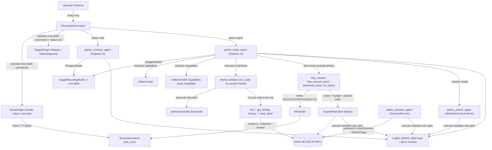

# How `partex` uses the Pydantic AI stack

`partex` pairs interactive LLM reasoning with deterministic, code-enforced security boundaries across the [Pydantic](https://github.com/pydantic/pydantic) ecosystem. Where a general coding assistant gives a model broad workspace and shell authority, `partex` inverts the defaults: **a deterministic Python engine owns authorization, sockets, scope, secret redaction, SQLite durability, and findings**, while **Pydantic AI, Pydantic AI Harness, Pax, Monty, and Logfire** provide typed contracts, capability isolation, sandboxed analysis, an operator-controlled terminal shell, and local-first observability.

For background on Pydantic's terminal client, capability SDK, and execution-boundary design, see Pydantic's [Pax & Pydantic AI Harness beta announcement](https://pydantic.dev/articles/pax-harness-beta) and [Code Mode vs. Sandboxes](https://pydantic.dev/articles/code-mode-vs-sandboxes).

---

## 1. Stack inventory & architecture

### Locked components

Every package below resolves from PyPI through hash-pinned [`uv.lock`](uv.lock) (with no `[tool.uv.sources]` path overrides, per [`pyproject.toml`](pyproject.toml)):

| Component | Locked version | Role in `partex` | Primary modules |
| --- | --- | --- | --- |
| **Pydantic** (`pydantic`) | `2.14.3` | Strict data contracts (`extra='forbid'`), discriminated `Evidence` union, `TypeAdapter`, dynamic decision schemas | [`models.py`](src/partex/models.py), [`engagement.py`](src/partex/engagement.py), [`bundle.py`](src/partex/bundle.py), [`storage.py`](src/partex/storage.py), [`decide.py`](src/partex/agent_adapter/decide.py) |
| **Pydantic AI** (`pydantic-ai-slim[google]`) | `2.76.0` | Four role-isolated `Agent`s, deferred `Capability` playbooks, untrusted-data framing, `WebSearch(local=None)`, `WrapperModel`, calibrated Decisions | [`agent_adapter/`](src/partex/agent_adapter/__init__.py), [`models_config.py`](src/partex/models_config.py) |
| **Pydantic AI Harness** (`pydantic-ai-harness[repair-tool-arguments]`) | `0.76.0` | `CodeMode`, `CodeModeResourceLimits`, `DetectLoops`, `ask_user` schemas, tool-argument repair | [`tester.py`](src/partex/agent_adapter/tester.py), [`approval.py`](src/partex/agent_adapter/approval.py) |
| **Pax** (`pydantic-ai-pax`, formerly `pydantic-clai2`) | `0.76.0` | Capability-aware terminal `chat()` loop, `Settings`/`SettingsStore`, operator-only `Plugin`s, `TerminalAnswerer` picker | [`agent_adapter/__init__.py`](src/partex/agent_adapter/__init__.py), [`scope_plugin.py`](src/partex/agent_adapter/scope_plugin.py), [`targets_plugin.py`](src/partex/agent_adapter/targets_plugin.py), [`approval.py`](src/partex/agent_adapter/approval.py) |
| **Monty** (`pydantic-monty`, `-client`, `-runtime`) | `1.7.0` | In-process restricted Python subset sandbox (`run_code`) + read-only `/artifacts` `MountDir` | [`tester.py`](src/partex/agent_adapter/tester.py), [`sandboxes.py`](src/partex/sandboxes.py) |
| **Logfire** (`logfire`) | `5.6.0` | Local mode-`0600` JSONL span log by default, opt-in `--logfire` remote export, `instrument_pydantic_ai()`, manual metadata spans | [`telemetry.py`](src/partex/telemetry.py), [`target.py`](src/partex/target.py), [`search.py`](src/partex/agent_adapter/search.py), [`decide.py`](src/partex/agent_adapter/decide.py) |
| **httpx2** (`httpx2`, via the Pydantic AI stack) | `2.16.2` | `ScopedHttpClient` pinned-resolver transport with `follow_redirects=False` | [`target.py`](src/partex/target.py) |

### Layer boundary

Only [`src/partex/agent_adapter/`](src/partex/agent_adapter/__init__.py) imports `pydantic_ai_pax` (and only `target.py` opens engine HTTP sockets). Deterministic passive checks, storage, scope rules, and `partex review` / `partex test` / `partex verify` run completely without Pax, Monty, or any LLM.

### End-to-end component map



---

## 2. Pax (`pydantic-ai-pax`, formerly `pydantic-clai2`)

### Rename & packaging background

In the Pydantic ecosystem, `pydantic-clai2` was renamed to **`pydantic-ai-pax`** (`pydantic-clai2 0.76.0` is now a deprecated wrapper depending on `pydantic-ai-pax==0.76.0`). `partex` imports directly from `pydantic_ai_pax` across [`src/partex/agent_adapter/__init__.py`](src/partex/agent_adapter/__init__.py), [`scope_plugin.py`](src/partex/agent_adapter/scope_plugin.py), [`targets_plugin.py`](src/partex/agent_adapter/targets_plugin.py), and [`approval.py`](src/partex/agent_adapter/approval.py), while keeping legacy directory/prefix names such as `<db>.clai2/` and `partex-clai2-` for state compatibility.

### Stock Pax vs. how `partex` embeds Pax

As described in [the Pax & Harness beta post](https://pydantic.dev/articles/pax-harness-beta), stock Pax (`pax`) is a full terminal coding agent built around Harness's `Coder` plugin, workspace `CodeMode`, MCP integrations, and user-installed plugins. `partex` takes the **custom-agent embedding path** (`chat(agent, ...)`), using Pax strictly as a streaming TUI shell and plugin host while stripping out coding and host-access surfaces:

| Stock Pax behavior | How `partex` configures Pax | Why |
| --- | --- | --- |
| Built-in `Coder` agent (`FileSystem`, shell, editor) | Replaced by bespoke `partex_reviewer_agent` (`chat`) or `partex_tester_agent` (`agent`) | Target responses are untrusted data; the model must never read/write arbitrary host files or run shell commands |
| Workspace `CodeMode` & speculative reads | `CHAT_SETTINGS = Settings(model=None, code_mode=False, speculative_code_mode=False, session_namer=False)` | Prevents Pax's `WorkspaceCodeMode` from mounting the host CWD; `model=None` prevents saved Pax defaults from overriding `--model`; `session_namer=False` prevents 250-token reasoning-model failures and stops engagement text from being re-sent to a second LLM call |
| User's global Pax config & drop-in plugins | `partex chat` uses `<db>.clai2/config.db` (`0o700`); `partex agent` uses an ephemeral `tempfile.TemporaryDirectory(prefix='partex-clai2-')` `SettingsStore` | Keeps the operator's personal Pax settings, MCP servers, and third-party plugins out of live engagements |
| All default plugins enabled | Explicit `builtin_plugins=(...)` allowlist (`TargetsPlugin` for `chat`; `ScopePlugin` + `TargetsPlugin` for `agent`) | `load_plugins=True` is enabled *only* to load `partex`'s own audited plugins while keeping `partex.db.clai2/` isolated |
| Pax CLI request limit | Explicit `usage_limits=UsageLimits(request_limit=request_limit)` (`DEFAULT_REQUEST_LIMIT = 200` in CLI, `40` in `partex.sh`) | `pydantic_ai_pax.chat()` does not apply Pax CLI's `request_limit` setting automatically, so pydantic-ai's default of 50 would otherwise stop long investigations mid-turn |

> **Import-order subtlety:** In [`src/partex/agent_adapter/__init__.py`](src/partex/agent_adapter/__init__.py#L21-L23), `from pydantic_ai_pax import chat` is imported at module top level before any tool calls `frame_untrusted`. Pax registers its own framing tags at import time, and registering tags after escaping has started changes how earlier framed text renders.

### Operator-only Pax plugins (`Plugin`, `Command`, `StatusSegment`)

In Pax, slash commands are intercepted by the terminal shell and **never sent to the model**. `partex` uses this channel to separate **operator authority** from **model authority**. Both plugins implement `get_capabilities()` returning `()`, guaranteeing that plugin state and cross-target data never enter model context.

1. **`ScopePlugin` (`partex_scope`)** — [`src/partex/agent_adapter/scope_plugin.py`](src/partex/agent_adapter/scope_plugin.py)
   - `Plugin[NoSettings]`, bridged to the active `LiveSession` via `current_control: ContextVar[ScopeControl | None]`.
   - Registers three operator-only commands:
     - `/scope [add <host[:port]|url> | nmap <scan.xml> | confirm | cancel]`: A two-step stage/confirm state machine (`ScopeControl`) with tab completion (`SUBCOMMANDS`). `/scope add` and `/scope nmap` only preview additions and TLS warnings (`-k`); nothing takes effect until the operator explicitly types `/scope confirm`.
     - `/report [path]`: Writes a secret-redacted Markdown report to `<db>.exports/<run_id>.report.md` (or `path`), printing only the path and counts.
     - `/secrets [path]`: Writes unredacted captured secrets to a mode-`0600` file without echoing any secret values into the chat transcript.
   - **Terminal write-approval binding:** Inside `get_capabilities()`, `ScopePlugin` sets `control.write_gate.ask = terminal_asker(self.host)` **only if `self.host.console.is_terminal` is true**. Headless or non-TTY sessions leave `write_gate.ask = None`, so every state-changing HTTP request fails closed.

2. **`TargetsPlugin` (`partex_targets`)** — [`src/partex/agent_adapter/targets_plugin.py`](src/partex/agent_adapter/targets_plugin.py)
   - `Plugin[TargetsPluginSettings]` (strict frozen Pydantic `BaseModel` accepting an optional `db: str | None = None`), bridged via `current_targets: ContextVar[TargetsControl | None]`.
   - Supports three operating modes:
     - **Live `partex agent`:** Reads `LiveSession` scope and captured evidence in memory + SQLite.
     - **Read-only `partex chat`:** Pre-loads a `DiscoveryRollup` via `RunReader`.
     - **Standalone `pax`:** When `current_targets` is `None`, reads `TargetsPluginSettings.db` → `$PARTEX_DB` → `state_dir() / 'partex.db'`.
   - Registers `/targets [host | --all | --findings | --help]` with dynamic flag and target-host tab completion (`complete=control.completions`).
   - Implements `get_status_segments()` returning a synchronous, I/O-free `StatusSegment` badge (`bound.status_segment`) showing discovered origins, reachable origins, and finding counts in Pax's status bar when bound to a session.

### Inline write-approval picker (`TerminalAnswerer` + `ask_user`)

State-changing requests (`POST`, `PUT`, `PATCH`, `DELETE`) in [`src/partex/agent_adapter/approval.py`](src/partex/agent_adapter/approval.py) combine Pax's inline terminal UI with Harness's typed question contracts:

- `WriteGate.decide()` checks whether the exact `method + scheme + host + port + path` was already approved for the session; otherwise it invokes the bound `Asker`.
- `terminal_asker(host)` subclasses `pydantic_ai_pax.builtin_plugins.ask_user_menu.TerminalAnswerer` (`_WriteAnswerer`), renders a credential-scrubbed `WriteAction` preview (`body_preview` capped at `300` chars), and invokes `self._ask(approval_request(...), held=held)`.
- `decision_from(response)` fails closed: only exact selection of `Approve` or `Approve for this session` permits sending; cancellation, `Deny`, or a custom typed answer denies the request and feeds the denial reason back to the model. Because `TerminalAnswerer._ask` is an internal Pax API, [`tests/test_write_approval.py`](tests/test_write_approval.py) asserts compatibility on dependency bumps.

---

## 3. Pydantic AI Harness (`pydantic-ai-harness`)

[Pydantic AI Harness](https://pydantic.dev/articles/pax-harness-beta) packages reusable agent capabilities (`capabilities=[...]`) for long-running agents: workspaces, loop detection, code mode, sub-agents, memory, and `ask_user` interaction primitives.

Rather than adopting Harness's full `Coder` preset, `partex` cherry-picks three Harness components and attaches them directly to `partex_tester_agent` in [`src/partex/agent_adapter/tester.py`](src/partex/agent_adapter/tester.py) and [`approval.py`](src/partex/agent_adapter/approval.py):

| Harness primitive | Import & config | What it does in `partex` |
| --- | --- | --- |
| **`CodeMode` & `CodeModeResourceLimits`** | `pydantic_ai_harness.code_mode` (`code_mode_capability()` in [`tester.py`](src/partex/agent_adapter/tester.py#L657-L675)) | Exposes Monty-backed `run_code` directly on `partex_tester_agent` over the 10 read tools and read-only `/artifacts` mount |
| **`DetectLoops`** | `pydantic_ai_harness.DetectLoops` ([`tester.py`](src/partex/agent_adapter/tester.py#L781)) | Attached in `capabilities=[DetectLoops(), code_mode_capability(artifacts_dir), *skills]` to detect and nudge repetitive probe loops before they burn `max_requests` or `request_limit` |
| **`ask_user` contracts** | `AskUserRequest`, `AskUserResponse`, `Question`, `QuestionOption` from `pydantic_ai_harness.ask_user` ([`approval.py`](src/partex/agent_adapter/approval.py#L19)) | Typed schema shared between `WriteGate` and Pax's `TerminalAnswerer` for operator write approvals |
| **`repair-tool-arguments` extra** | `pydantic-ai-harness[repair-tool-arguments]` in [`pyproject.toml`](pyproject.toml#L13) | Repairs malformed JSON tool-call arguments emitted by open-weights or fast models |

### Open Harness roadmap items ([`RUNTIME.md`](RUNTIME.md))

Two Harness enhancements are specified in [`RUNTIME.md`](RUNTIME.md#L19-L71) as open M5 items:
1. Attaching `CodeMode(tools=['list_findings', 'get_finding', 'lookup_evidence'], eager=True, mount=None, os_access=None)` directly onto `partex_reviewer_agent` (`partex chat`) while keeping Pax's workspace `CodeMode` disabled.
2. Benchmarking opt-in **speculative execution** (`CodeMode(..., speculate=['list_findings', 'get_finding', 'lookup_evidence'])`) directly on `partex_reviewer_agent`, avoiding Pax's stock `SpeculativeExecution` allowlist (`SPECULATIVE_TOOLS`, which hardcodes `FileSystem` and `ClaiDocs`).

---

## 4. Monty (`pydantic-monty`)

Monty (`pydantic-monty`, `pydantic-monty-client`, `pydantic-monty-runtime` pinned at `1.7.0`) is a minimal Python-subset interpreter written in Rust. `partex` pairs Monty with Harness's `CodeMode` so the tester agent can correlate findings, filter captured responses, inspect downloaded JavaScript or OpenAPI artifacts, and generate candidate probe lists in a single turn without spawning Docker/microVMs or granting CPython authority.

### Code Mode vs. Sandboxes: where `partex` puts the boundary

As [Code Mode vs. Sandboxes](https://pydantic.dev/articles/code-mode-vs-sandboxes) explains, **Code Mode** and **Sandboxes** solve different problems:

- **Code Mode is about *how* the model calls tools:** Instead of paying a full model round-trip per JSON tool call, the model writes a short Python script that loops, filters, and aggregates intermediate data so only the concise result returns to the LLM context.
- **A Sandbox is about *where* code executes and *what* it can touch:** It is the isolation boundary protecting the host from model-generated or untrusted code.

Rather than placing the entire agent inside a heavyweight container or VM (which adds daemon/startup overhead and still has to guard engagement credentials and egress), `partex` combines two tighter boundaries:

1. **Code-only isolation via Monty:** The agent harness and engine stay in-process on the host, while *only* LLM-generated analysis code (`run_code`) runs inside Monty with zero ambient authority (no default filesystem, env vars, clock, shell, or network) and sub-millisecond session startup.
2. **Tool-level isolation outside Monty:** Every side-effecting tool (`http_request`, `http_request_batch`, `download_asset`, `discover_js_assets`, `run_check`, `save_report`, `web_search`) remains a direct tool outside `run_code`, enforced in Python by `ScopedHttpClient`, `WriteGate`, and `RunStore`.

Because `partex`'s analysis scripts do not need `git`, shell utilities, or arbitrary third-party CPython packages, Monty delivers Code Mode's token and latency gains with zero container daemon requirement.

### Exact sandbox configuration

In [`code_mode_capability()`](src/partex/agent_adapter/tester.py#L652-L675):

```python
ARTIFACTS_MOUNT = '/artifacts'
CODE_MODE_MAX_TOOL_CALLS = 50
CODE_MODE_LIMITS = CodeModeResourceLimits(max_duration_seconds=10.0, max_memory=256 * 1024 * 1024)

mount = (
    MountDir(virtual_path=ARTIFACTS_MOUNT, host_path=artifacts_dir, mode='read-only')
    if artifacts_dir is not None
    else None
)
return CodeMode(
    tools=list(CODE_MODE_TOOLS),
    eager=True,
    mount=mount,
    os_access=None,
    max_tool_calls=CODE_MODE_MAX_TOOL_CALLS,
    resource_limits=CODE_MODE_LIMITS,
)
```

Key isolation guarantees:
- **Zero OS authority (`os_access=None`):** No host environment variables, wall clock, arbitrary filesystem, network sockets, or subprocesses (`import socket` and `import subprocess` fail).
- **Per-run read-only artifact mount (`MountDir`):** Only `<db>.artifacts/<run_id>/` is mounted at `/artifacts` with `mode='read-only'`. Earlier runs' artifacts stay invisible, and writes raise `PermissionError`.
- **Bounded execution:** `eager=True` begins executing complete statements as the model streams code; `max_tool_calls=50`, `max_duration_seconds=10.0`, and `256 MiB` memory cap prevent runaway snippets; sandbox state starts fresh per session and is discarded on exit.

### Tool-partitioning boundary: inside vs. outside `run_code`

`CodeMode` wraps **only** `CODE_MODE_TOOLS` (`REVIEWER_TOOLS`), making them callable *only* from inside `run_code`. Every side-effecting, network-touching, or persistence-writing tool stays a direct agent tool outside Monty:

| Inside Monty (`run_code` only) | Direct agent tools (outside Monty) | Why separated |
| --- | --- | --- |
| `list_runs`, `list_findings`, `get_finding`, `list_evidence`, `list_coverage`, `lookup_evidence`, `list_research`, `lookup_research`, `list_reports`, `read_report` | `http_request`, `http_request_batch`, `download_asset`, `discover_js_assets`, `run_check`, `save_report`, `web_search` | A snippet inside `run_code` that names `http_request` or `run_check` gets a `NameError`; scope checks, RPS pacing, request budgets, write approvals, and SQLite audit rows can never be bypassed or looped silently inside generated Python |

In practice, [`TESTER_INSTRUCTIONS`](src/partex/agent_adapter/tester.py#L697-L710) guides the model to use `run_code` to inspect `/artifacts/<sha256>` or aggregate `list_evidence`/`lookup_evidence`, compute a filtered list of paths in Python, and pass up to 50 safe paths to `http_request_batch` in one direct call.

### Working within Monty's Python subset

Because Monty is not CPython, `TESTER_INSTRUCTIONS` explicitly teaches the model Monty's exact contract:
- Nothing is preloaded — snippets must import what they use (`import re, json; from pathlib import Path`).
- Downloaded files live at `/artifacts/<sha256>` with no file extension (`list_evidence` maps URLs to hashes).
- `pathlib.Path` is a subset: sort paths with `key=str` and call `read_text()` with no arguments.
- Wrapped read tools return `<partex_untrusted_data kind=...>` framed strings, so snippets strip the framing tags before `json.loads(...)`.

### Sandbox detection & microVM deferral

[`src/partex/sandboxes.py`](src/partex/sandboxes.py) implements `partex sandboxes`, checking Monty (`check_monty()`), `docker`, `podman`, and Linux `bubblewrap` via argument-list probes (never a shell). Because `partex` only runs short data-correlation snippets in `run_code`, Monty provides fast language-level isolation with zero external container daemon; full OS/CPython environments (containers or microVMs such as BoxLite or Smol) remain deferred in [`RUNTIME.md`](RUNTIME.md#L95-L100) until an offline analysis task genuinely requires packages or binaries unavailable in Monty.

---

## 5. Pydantic AI core (`pydantic-ai-slim`)

### Four role-isolated `Agent`s

| Agent name | Role & CLI path | Tools & capabilities | Isolation boundary | Source |
| --- | --- | --- | --- | --- |
| `partex_reviewer_agent` | Read-only offline review (`partex chat <run-id>`) | `REVIEWER_TOOLS` (10 read tools) + deferred skill `Capability`s | `mode=ro` `RunReader`; no HTTP client, no checks, no write tools, no Monty mount | [`reviewer.py`](src/partex/agent_adapter/reviewer.py) |
| `partex_tester_agent` | Interactive live probing (`partex agent <engagement>`) | `TESTER_TOOLS` (+ `web_search` if `-S`) + `DetectLoops` + `CodeMode` + deferred skills | `RunStore` + `LiveSession`; scope/rate/budget enforced in `ScopedHttpClient`, writes gated by `WriteGate`, optional read-only HAR `seed_surface` | [`tester.py`](src/partex/agent_adapter/tester.py) |
| `partex_search_agent` | Optional public-web lookup (`--search-model` / `-S`) | `WebSearch(local=None)` capability only (`tools=()`) | Zero host tools, zero deps (`deps_type=None`), zero DB/filesystem/target access; `validate_search_query` blocks secrets/URLs/IDs; max 20 calls, max 20 sources; results saved to `web_research` | [`search.py`](src/partex/agent_adapter/search.py) |
| `partex_decision_agent` | Closed-set prefill classifier (`--decision-model` / `-D`, `#256`) | Zero tools, zero deps, `InstrumentationSettings(include_content=False)` | Stateless one-shot `DecisionRunner`; bounded redacted `<partex_untrusted_data>` excerpts; per-call timeout & session cap; never overwrites `runs.model` | [`decide.py`](src/partex/agent_adapter/decide.py) |

All four agents set `defer_model_check=True` so constructing agents in offline workflows or tests never requires live provider API keys.

### Deferred skills (`Capability`)

[`src/partex/agent_adapter/skills.py`](src/partex/agent_adapter/skills.py) converts validated Markdown playbooks under [`skills/`](skills/) into `Capability(id=skill.name, description=..., instructions=text, defer_loading=True)`. The model only sees a one-line catalog (`[modes] description`) until it calls Pydantic AI's `load_capability` tool, which pulls the `SKILL.md` body and `reference/*.md` files (capped at `MAX_SKILL_CHARS = 60_000`) as pure guidance — never executable code.

### Untrusted-data framing (`pydantic_ai.framing`)

Target HTTP responses, captured configs, findings, opening briefings, search results, and decision excerpts are all attacker-influenced. [`src/partex/agent_adapter/tools.py`](src/partex/agent_adapter/tools.py#L27-L29) registers two tags at import time:
- `UNTRUSTED_TAG = register_tag('partex_untrusted_data')`
- `BRIEFING_TAG = register_tag('partex_briefing')`

Every model-facing return path passes through `wrap(...)` (and `frame_decision_excerpt()` in `decide.py`), which escapes any embedded closing `</partex_untrusted_data>` or `</partex_briefing>` sequences inside target bodies before returning text to the model.

### `WrapperModel` usage accounting & provider resolution

- **`UsageRecordingModel(WrapperModel)`** ([`src/partex/agent_adapter/usage.py`](src/partex/agent_adapter/usage.py)): Wraps the resolved `Model` rather than the `Agent` so every turn driven internally by Pax's `chat()` loop increments `model_calls`, `input_tokens`, and `output_tokens` in SQLite `runs`. `_PRIMARY_MODEL_ROLES = frozenset({'tester', 'reviewer'})` ensures auxiliary `'search'` and `'decision'` calls record token spend without overwriting `runs.model`.
- **Multi-provider resolution** ([`src/partex/models_config.py`](src/partex/models_config.py)): Resolves Pydantic AI Gateway (`gateway_provider`), direct `provider:model` strings, Vertex ADC (`GoogleCloudProvider`), Google safety-filter overrides (`GoogleModelSettings`), native-search provider settings (`AnthropicModelSettings` with `allowed_callers=['direct']` & `max_uses=3`, `OpenAIResponsesModelSettings` with `openai_include_web_search_sources=True`), and decision backends (`GoogleDecisionsModel`, `OpenAIDecisionsModel`, or uncalibrated `AnthropicModel` via `NativeOutput`).
- **Calibrated closed-set Decisions (`DecisionRunner`)** ([`src/partex/agent_adapter/decide.py`](src/partex/agent_adapter/decide.py)): Dynamically builds a Pydantic output model from `ChoiceSpec` mappings (`Annotated[Literal[label], Field(description=desc)]`) so Pydantic AI emits `ChoiceQuestion`s, validates calibrated distributions from `provider_details['probabilities']` (never synthesizing `p=1.0` when `calibrated=False`), enforces positive predicates via `assert_positive_predicate()`, and converts `DecisionHandOff`, `ContentFilterError`, timeouts, and API failures into typed non-raising `DecisionResult`s.

---

## 6. Pydantic v2 (`pydantic`) & Logfire (`logfire`)

### Pydantic v2 data contracts

- **Strict validation (`ConfigDict(extra='forbid')`):** Enforced across [`models.py`](src/partex/models.py) (`HttpExchange`, `ConfigExcerpt`, `ArtifactAsset`, `FindingDraft`, `Finding`, `Verification`, `Scope`), [`engagement.py`](src/partex/engagement.py), [`bundle.py`](src/partex/bundle.py), and [`targets_plugin.py`](src/partex/agent_adapter/targets_plugin.py) (`TargetsPluginSettings`).
- **Discriminated union & `TypeAdapter`:** `EvidenceType = Annotated[Evidence, Discriminator('kind')]` and `EvidenceAdapter = TypeAdapter(EvidenceType)` validate `http`, `config`, and `artifact` records uniformly across bundle import, SQLite persistence, and canonical JSON export.
- **Dynamic decision schema generation:** `_build_output_model()` in [`decide.py`](src/partex/agent_adapter/decide.py#L166-L175) calls `pydantic.create_model('PartexDecisionOutput', __config__=ConfigDict(extra='forbid'), **fields)` per closed-set batch.

### Logfire observability ([`src/partex/telemetry.py`](src/partex/telemetry.py))

- **Local-first JSONL trace log:** Commands in `LOGGED_COMMANDS` (`review`, `test`, `verify`, `chat`, `agent` — plus `validate` in [`scripts/validate_run.py`](scripts/validate_run.py)) write spans via `SimpleSpanProcessor(JsonlSpanExporter(log_path))` to a lazily created mode-`0600` JSONL file under `$PARTEX_STATE_DIR/logs/`.
- **Remote export & suppression:** `send_to_logfire` stays `False` unless `--logfire` or `PARTEX_LOGFIRE=1` is passed (`'if-token-present'`). When telemetry is disabled, `suppress_unconfigured_warning()` sets `logfire.DEFAULT_LOGFIRE_INSTANCE.config.ignore_no_config = True` without calling `logfire.configure()`.
- **No HTTP client auto-instrumentation:** `logfire.instrument_pydantic_ai()` is enabled when telemetry is configured, while `logfire.instrument_httpx()` is strictly forbidden (asserted in [`tests/test_cli.py`](tests/test_cli.py#L673-L676)) because `ScopedHttpClient` carries live engagement credentials. Instead, [`target.py`](src/partex/target.py#L409-L428) emits manual metadata-only `logfire.span('target request {method} {host}{path}', ...)` spans that redact secrets and catch exceptions before Logfire can record raw URLs or payloads.
- **Content scrubbing:** By default Logfire scrubs sensitive keys/values across tool results; passing `--logfire-content` (`PARTEX_LOGFIRE_CONTENT=1`) attaches `ScrubbingOptions(callback=keep_content)` to preserve `CONTENT_ATTRIBUTES` (`gen_ai.input.messages`, `gen_ai.output.messages`, `gen_ai.tool.call.*`, `final_result`), while `DecisionRunner` keeps `InstrumentationSettings(include_content=False)` unless explicitly opted in.

---

## 7. Security & engineering invariants at a glance

| Invariant | Enforcing mechanism in the Pydantic stack | Source |
| --- | --- | --- |
| No host filesystem, shell, or MCP access in chat/agent | Pax `Settings(code_mode=False, speculative_code_mode=False)`, ephemeral `SettingsStore`, explicit `builtin_plugins` allowlist | [`agent_adapter/__init__.py`](src/partex/agent_adapter/__init__.py) |
| Model cannot alter scope, export secrets, or approve its own writes | Pax operator-only `Plugin`/`Command`s returning `get_capabilities() == ()`; `TerminalAnswerer` bound only on real TTYs | [`scope_plugin.py`](src/partex/agent_adapter/scope_plugin.py), [`approval.py`](src/partex/agent_adapter/approval.py) |
| Generated Python cannot reach the network or bypass budgets | Harness `CodeMode` wraps `REVIEWER_TOOLS` only; Monty runs with `os_access=None` and read-only `/artifacts` `MountDir` | [`tester.py`](src/partex/agent_adapter/tester.py) |
| Untrusted target content cannot spoof instructions or escape tags | `pydantic_ai.framing.register_tag` + `wrap` on all tool/briefing/search/decision outputs | [`tools.py`](src/partex/agent_adapter/tools.py), [`decide.py`](src/partex/agent_adapter/decide.py) |
| Skills remain inert Markdown guidance | `Capability(..., defer_loading=True)` loads Markdown text via `load_capability`; never imported or executed | [`skills.py`](src/partex/agent_adapter/skills.py) |
| Web search & decisions cannot leak engagement state or touch targets | Separate one-shot `Agent`s (`deps_type=None`, `tools=()`), query egress filter, metadata-only decision spans | [`search.py`](src/partex/agent_adapter/search.py), [`decide.py`](src/partex/agent_adapter/decide.py) |
| Target credentials never leak into telemetry traces | `instrument_httpx()` banned; manual metadata-only spans in `target.py`; mode-`0600` local JSONL default | [`telemetry.py`](src/partex/telemetry.py), [`target.py`](src/partex/target.py) |
