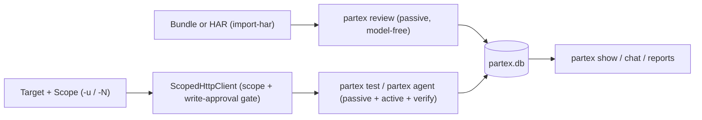

# partex


`partex` checks web and API traffic for security issues and links findings to the evidence behind them. Review saved traffic offline or run checks against systems you have permission to test.

The project grew out of a review of ARTEX and other open-source security testing projects. Their workflows inspired how `partex` organizes assessments, keeps evidence with findings, and packages testing guidance. The engine is a standalone Python implementation.  See [project lineage and evolution](LINEAGE.md) and [sources and tools analyzed](docs/lineage/SOURCES.md) and [design](PLAN.md)

## Pydantic Components

[Pydantic](https://github.com/pydantic/pydantic) validates inputs such as assessment settings and captured traffic. [Pydantic AI](https://pydantic.dev/docs/ai/overview/) connects models to the tools they can use, and its [CLAI2](https://pypi.org/project/pydantic-clai2/) package provides the interactive terminal. [Monty](https://pydantic.dev/docs/monty/get-started/) runs model-generated Python in a sandbox when the interactive session needs to work with saved evidence.

- **Pydantic** (`pydantic`): Evidence and engagement records are `BaseModel`s with `extra='forbid'`, so unknown fields are rejected. Evidence is a discriminated union on `kind` (HTTP, config, and artifact), and `TypeAdapter` round-trips it through bundle import, SQLite storage, and export. Engagement validation errors are mapped onto the E-rule failure modes.
- **Pydantic AI** (`pydantic-ai-slim`): `Agent` and `RunContext` back the read-only reviewer and the live tester. `Capability` defers each skill playbook until the model calls `load_capability`. `WebSearch(local=None)` runs provider-native search in a separate agent with no function tools. `framing.wrap` and `register_tag` mark tool results as untrusted target data. A `WrapperModel` records token usage for each request in `llm_usage`.
- **Pydantic AI Harness** (`pydantic-ai-harness`): Supplies `CodeMode`, which connects Monty to the agent, and the `ask_user` request type that write approvals use.
- **CLAI2** (`pydantic-clai2`): `chat()` runs the terminal loop. `/scope` and `/targets` are CLAI2 `Plugin`s with operator-only `Command`s (`partex chat` loads only the read-only `/targets` plugin). Write approvals reuse CLAI2's `TerminalAnswerer` picker, and chat history and settings are stored in `partex.db.clai2/`.
- **Monty** (`pydantic-monty`): The live tester's `run_code` tool runs with `eager=True`, `max_tool_calls=50`, a 10-second limit, and 256 MiB of memory. `/artifacts` is a read-only `MountDir` holding the run's downloads. `os_access` is `None`, so the sandbox has no environment, clock, network, or shell. `partex sandboxes` reports the installed Monty version.

[Runtime](RUNTIME.md) · [Dependencies](DEPS.md)

## Quick start

From the repository root, use Python 3.14 or newer and `uv`:

```sh
uv sync --frozen
uv run partex review fixtures/bundles/valid --all
```

This example reviews bundled HTTP traffic offline. It prints sample findings and exits with code `3` when it finds issues.

## What you can do

- **Run authorized live checks.** Capture responses within a defined target scope and request budget, then save the evidence alongside the findings.
- **Authorize targets from a URL list or a scan.** Restrict a session to an exact URL list (`-u urls.txt`), or import authorized targets from `nmap -oX` scan output (`-N scan.xml`): each open HTTP(S) port becomes a `scheme://host:port/*` entry, and ports running other services are reported and skipped.
- **Work with saved results.** List past runs, export reports or captured traffic, and use read-only chat to review findings and their evidence.
- **Review captured traffic.** Import a browser's HTTP archive (HAR) and check saved responses for issues such as missing security headers or insecure cookie settings. Offline checks run without a model.



## Skills, checks, and plugins

Skills are Markdown playbooks in [`skills/`](skills/) that the interactive session loads on demand with `load_capability`. Each skill names the check it runs with. The checks are Python code registered through the `partex.checks` entry point and run by the engine; the skill only tells the model when to use them. Run `uv run partex checks` to see the installed checks and their linked skills.

| Skill | Mode | Check | What it covers | Playbook and references |
| --- | --- | --- | --- | --- |
| [`header-review`](skills/header-review/SKILL.md) | passive | [`header-security`](src/partex/checks/header_security.py) | Missing or weak security headers (HSTS, CSP, framing, `X-Content-Type-Options`), cookie attributes, and permissive CORS, applied by response type | [response policies](skills/header-review/reference/response-policies.md), [research notes](docs/skills/header-review.md) |
| [`version-disclosure`](skills/version-disclosure/SKILL.md) | active | [`version-disclosure`](src/partex/checks/version_disclosure.py) | Server and framework version banners and stack traces, confirmed by replaying a single request | [verification criteria](skills/version-disclosure/reference/verification-criteria.md), [research notes](docs/skills/version-disclosure.md) |
| [`js-analysis`](skills/js-analysis/SKILL.md) | passive | [`js-analysis`](src/partex/checks/js_analysis.py) | Full JavaScript bundles downloaded in scope and parsed offline with `tree-sitter` for endpoints, embedded config, and risky DOM sinks; fetches and parses exposed source maps and flags high-entropy embedded secrets | [analysis rules](skills/js-analysis/reference/analysis-rules.md) |
| [`api-inventory`](skills/api-inventory/SKILL.md) | passive | [`api-contract-conformance`](src/partex/checks/api_inventory.py) | A normalized inventory of observed API operations, reconciled against declared OpenAPI contracts (shadow routes, unobserved operations, schema gaps) | [contract matching](skills/api-inventory/reference/contract-matching.md), [research notes](docs/skills/api-inventory.md) |
| [`openapi-spec-review`](skills/openapi-spec-review/SKILL.md) | passive | [`openapi-spec-review`](src/partex/checks/openapi_spec_review.py) | Spec-level gaps in OpenAPI 3.0 and 3.1 documents: missing authentication, weak security schemes, internal server URLs, credential query parameters, and sensitive response properties | none |
| [`server-error`](skills/server-error/SKILL.md) | passive | [`server-error`](src/partex/checks/server_error.py) | Unhandled HTTP 5xx responses and debug-page disclosure already present in captured evidence | none |
| [`authorization-testing`](skills/authorization-testing/SKILL.md) | active and passive | [`authz-boundary`](src/partex/checks/authorization.py) | Broken object-level and function-level authorization (BOLA, IDOR, BFLA) by replaying operations across two engagement roles | [role-pair probing](skills/authorization-testing/reference/role-pair-probing.md), [research notes](docs/skills/authorization-testing.md) |
| [`auth-session-controls`](skills/auth-session-controls/SKILL.md) | passive and active | Not yet registered | Session cookie configuration and token lifecycle weaknesses. Its checks (`session-cookie-config`, `token-weakness`) are not installed, so the skill is left out of the catalog until they are | [session and token checks](skills/auth-session-controls/reference/session-and-token-checks.md), [research notes](docs/skills/auth-session-controls.md) |
| [`graphql`](skills/graphql/SKILL.md) | passive and active | No check (playbook only) | GraphQL endpoint testing: introspection, field suggestions, federation subgraphs, and CSRF protections; per-field, nested-edge, and per-mutation authorization with role-pair replay; batching, alias, and depth-limit observation | none |
| [`regression-verify`](skills/regression-verify/SKILL.md) | passive and active | No check (playbook only) | Re-verifying earlier findings against a changed target: replaying verification recipes and re-reviewing exported bundle revisions for regression drift between runs | none |

Each skill's research notes in [`docs/skills/`](docs/skills/README.md) record the standards and false-positive guardrails behind it. Additional checks can register through the same `partex.checks` entry point.

| Tools | What they do |
| --- | --- |
| `list_runs`, `list_findings`, `get_finding`, `list_evidence`, `lookup_evidence`, `list_coverage` | Inspect saved runs, findings, evidence, and check coverage. |
| `http_request`, `http_request_batch`, `download_asset`, `discover_js_assets`, `run_check` | Make scoped requests (one at a time or as a concurrent batch with per-item audit), save assets, find JavaScript files, and run installed checks during a live session. `POST`, `PUT`, `PATCH` and `DELETE` are off unless the engagement's `scope.allowed_methods` and `scope.max_write_requests` allow them, and then each one waits for you to approve it in the terminal; with no terminal they are denied. |
| `run_code`, `save_report` | Analyze evidence and downloaded artifacts in the Monty sandbox, or save a report from the live session. |
| `list_research`, `lookup_research` | Inspect web research saved by `web_search` for the current run or a chosen run. |
| `list_reports`, `read_report` | Retrieve Markdown saved by `save_report` for the current run or the live session’s `--from` run. |
| `load_capability` | Load a skill playbook from the catalog into the session when the model needs its guidance. |
| `web_search` | Optional. Look up public references through a separate `anthropic:`, `google:`, `google-cloud:`, or `openai:` model's native web search (`--search-model`, or `-S` in `partex.sh`). Queries leave this machine. |

`--search-model` takes `anthropic:<model>` (`ANTHROPIC_API_KEY`), `google:<model>` (`GOOGLE_API_KEY` or `GEMINI_API_KEY`), `google-cloud:<model>` (Application Default Credentials and `GOOGLE_CLOUD_PROJECT`), or `openai:<model>` (`OPENAI_API_KEY`, Responses API). OpenAI search has no per-query search limit and costs more per query than the others, so prefer a small model. `google-cloud:` uses the `global` location by default, since newer Gemini models are only served there; set `GOOGLE_CLOUD_LOCATION` to override it.

The terminal sessions include built-in CLAI2 plugins for operator commands. `/targets` (`TargetsPlugin`, also usable standalone in CLAI2 via `partex.agent_adapter.targets_plugin:TargetsPlugin`) gives a deterministic, redacted summary of what has been discovered across all targets in the current run or across saved runs (`--all`, `--findings`, or `/targets <host>`). In live `agent` sessions, `/scope` shows the current scope and requires operator confirmation for changes; with `-k` (`--insecure`), hosts it adds are not certificate-verified either, and the confirmation says so. `/scope nmap scan.xml` stages an nmap import for `/scope confirm`, which applies the whole batch as one recorded scope change that names the scan file and its hash. `/report` writes a redacted Markdown report, and `/secrets` writes secret values to a private file.

Use `partex reports RUN_ID` to list reports saved by `save_report` and `partex reports RUN_ID NAME` to print one as Markdown. Both forms accept `--db PATH` and `--json`.

## Active probe examples

Live checks send HTTP requests and require authorization. To try one against the bundled local test app, start it from the repository root:

```sh
uv run python fixtures/target_app/app.py
```

In a second terminal, run the launcher against the local URL. The launcher asks you to confirm authorization. This example needs no model API key.

```sh
./partex.sh --no-tui http://127.0.0.1:8765/
```

The version-disclosure check looks for evidence like this:

| Request | Example evidence |
| --- | --- |
| `GET /robots.txt` | A response header reveals the software version, such as `Server: FixtureTarget/2.3.1`. |
| `GET /partex-nonexistent-probe-0` | A `404` response includes internal details, such as a stack trace. |

To review that run with a model, resume the latest saved run in read-only chat. This example uses OpenRouter and requires `OPENROUTER_API_KEY`.

```sh
./partex.sh -m openrouter:deepseek/deepseek-v4.1-flash-1017 --resume
```

To use Z.ai's GLM-5.3 through Pydantic AI Gateway, set `PYDANTIC_AI_GATEWAY_API_KEY` and select the `doubleword` route. If the key's region cannot be inferred or you need a specific endpoint, set `PYDANTIC_AI_GATEWAY_BASE_URL` to the URL from your Gateway Connect page. The launcher accepts a URL that already ends in `/doubleword`.

```sh
./partex.sh -m zai-org/GLM-5.3 -r doubleword --resume
```

To run a live session using Gemini directly for both the main model (`-m`) and native `web_search` (`-S`), set `GEMINI_API_KEY` (or `GOOGLE_API_KEY`) and use the `google:` provider prefix. No Gateway key is needed when using a direct `google:` model string; omit `-S` to leave web search off (or pass `--resume` without `-S` for read-only chat).

```sh
./partex.sh -m google:gemini-3.8-flash -S google:gemini-3.8-flash http://127.0.0.1:8765/
```

If Gemini's configurable content filters interfere with a session (`finishReason: SAFETY` — authorized security testing discusses exploit and payload evidence, which the "dangerous content" category can flag), note that partex **disables them by default** for `google:` and `google-cloud:` model roles: startup prints the effective thresholds, and the provider's non-configurable CSAM and PII filters stay on regardless. To change the thresholds, set `PARTEX_GOOGLE_SAFETY_SETTINGS` to a preset (`off`, `high`) or a JSON `[{"category": "HARM_CATEGORY_…", "threshold": "BLOCK_…"}]` list; set on a non-Google model it refuses to start.

```sh
PARTEX_GOOGLE_SAFETY_SETTINGS=off ./partex.sh -m google:gemini-3.8-flash http://127.0.0.1:8765/
```

## Commands and documentation

- `./partex.sh --help` shows options for the interactive testing launcher.
- `./partex.sh -u urls.txt <target-url>` restricts the session to the URLs in `urls.txt` (one per line, `#` comments, a trailing `/*` allows a path prefix). The target URL is optional with `-u`: the first listed URL is used (an explicit one must be listed). A URL without a port covers both 80 and 443; add `:port` to pin one. Anything unlisted is refused by the scope gate. Add `--recursive` to treat every listed URL as a path prefix, so a file containing `http://foo/` allows everything under `foo`.
- `./partex.sh -N scan.xml <target-url>` imports authorized targets from `nmap -oX` scan output. Each open HTTP(S) port on an up host becomes a `scheme://host:port/*` entry in the session's URL list, so only scanned host:port targets can be requested. Ports running other services (SSH, databases, TLS-wrapped non-HTTP) are reported and skipped, never guessed. The session opens with one initial `GET` per listed target, each captured as evidence and shown live on a terminal; `--max-requests` is raised automatically when the import needs the room. The target URL is optional with `-N`: the first imported entry is used (an explicit one must be listed). Combine with `-u` to merge a hand-written list. Set `PARTEX_NMAP_FILE` to pass the scan without the flag.
- `uv run partex nmap scan.xml [--use-hostnames] [--out targets.txt]` converts a scan without opening a session: it prints the entries and the skip report, or writes them to a `--urls-file` with `# source:` lines recording each scan file and its hash, so you can review and edit the list before it becomes scope. With `--use-hostnames`, entries use the scan's PTR hostnames instead of the scanned IPs (reverse DNS can be stale, so IPs are the default). Several scan files merge, such as a plain sweep plus a `-sV` version pass.
- `./partex.sh -M write <target-url>` authorizes state-changing methods for the session (`read` is the default: GET/HEAD/OPTIONS only; `write` adds POST/PUT/PATCH, `delete` adds DELETE). Use `-w POST -W 20` instead to authorize individual methods with an explicit write budget. Every write still waits for your approval in the terminal; `--no-tui` denies them. `uv run partex agent` and `partex test` take the same policy as `--allow-method` / `--max-writes`.
- `uv run partex agent <engagement> --request-limit N` caps how many model turns one prompt may take (the same flag exists on `partex chat`); raise it for long investigations that chain many tool calls.
- `./partex.sh list` lists saved runs from the default database.
- `uv run partex --help` lists the available CLI commands.

To inspect a saved run, copy its ID from `./partex.sh list` and substitute it below.

```sh
uv run partex show RUN_ID --format text
```

This prints the saved evidence and findings. To open a particular run in chat, pass its ID after `--resume`.

## Local state

Set `PARTEX_STATE_DIR` to choose a directory for all local Partex state. The CLI and launcher interpret relative values from the directory you run them in.

```sh
export PARTEX_STATE_DIR="$HOME/partex-state"
```

Without this override, the CLI and launcher store local state under `$XDG_STATE_HOME/partex`. If `XDG_STATE_HOME` is unset, empty, or relative, they use `~/.local/state/partex`.
Partex keeps its local run database and history together so a single setting controls where its persistent state goes.

| Path within the state directory | Contents |
| --- | --- |
| `partex.db` | Saved runs, evidence, findings, and audit records |
| `partex.db.artifacts/` | Downloaded artifacts by run |
| `partex.db.reports/` | Saved Markdown reports by run |
| `partex.db.exports/` | Operator exports from `/report` and `/secrets` |
| `logs/` | Local JSONL traces |
| `partex.db.clai2/` | Read-only chat history and terminal settings for this database |

Use `--db PATH` or `PARTEX_DB` to select a different database. Its artifacts, reports, operator exports, and read-only chat history are stored alongside it. Live `agent` sessions use temporary terminal storage. Use `--log-file PATH` or `PARTEX_LOG_FILE` to select a different trace file. Commands that accept `--out` write to the path you provide.

Existing data stays where it is. To open previous runs, point `--db` at the original database, such as `./partex-probe.db` for the launcher or `${XDG_DATA_HOME:-$HOME/.local/share}/partex/partex.db` for the CLI.

