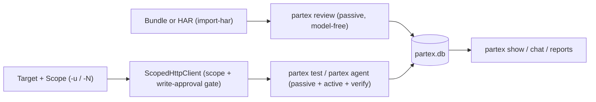

# partex

**`partex` is a local, terminal-native, evidence-first web and API security testing workbench in Python 3.14, built on the Pydantic AI stack.**

Review captured traffic offline with deterministic checks, probe authorized targets through a code-enforced scope gate, replay verification recipes, and run interactive AI investigation sessions backed by an auditable SQLite engagement record.

## Positioning & why `partex` exists

Web and API security testing usually splits into two extremes:

- **Traditional scanners and proxies** are deterministic and controllable, but brittle when reasoning about API contracts, business workflows, or cross-role authorization boundaries.
- **Autonomous AI pentesting platforms** are exploratory, but often arrive as heavy multi-service stacks (Docker, Postgres, web UIs, MITM proxies) that enforce scope in prompts, execute third-party skill scripts, and let models invent findings without replayable proof.

`partex` takes a deliberate middle path, built for two audiences:

- **Security engineers & operators** who want a controllable, reproducible, single-machine CLI/TUI workbench where every finding links to captured evidence and every outbound request passes a code-level scope gate.
- **AI & Pydantic engineers** studying a real-world reference architecture for pairing an LLM with hard security boundaries, sandboxed Code Mode, untrusted-data framing, and deterministic persistence.

The core boundary splits the work cleanly: **a deterministic Python engine owns authorization, network sockets, scope, secret redaction, SQLite durability, checks, and verification**, while **the AI agent owns interactive investigation, synthesis, and sandboxed evidence correlation**. Offline review and baseline active/verification runs work completely model-free; interactive sessions layer over the exact same store.

## What `partex` deliberately avoids

| Deliberate non-goal | What `partex` does instead |
| --- | --- |
| **No MITM proxy** | Captures traffic only through `partex`'s own `ScopedHttpClient`, operator-exported HAR files (`partex import-har`), and the planned M7 Playwright/CDP capture harness (`browser.py`) — never by intercepting external tools or browser traffic. |
| **No multi-user server or hosted daemon** | Built for one operator on one machine with a local SQLite (WAL) database (`partex.db`). No Postgres, message broker, or container cluster required. |
| **No GUI or web UI** | Terminal-first CLI and CLAI2 TUI (`partex chat`, `partex agent`, `./partex.sh`), scriptable and headless-capable for CI. |
| **Not completely autonomous** | Operator-in-the-loop by design: live runs require written engagement authorization (`--authorized`), strict scope/RPS/request budgets, operator confirmation for `/scope add` and `/scope nmap`, and interactive terminal approval for every state-changing request (`POST`/`PUT`/`PATCH`/`DELETE`, denied automatically when headless). The model can never mutate findings or scope directly. |
| **No executable skills** | Markdown playbooks under [`skills/`](skills/) are inert data loaded on demand via `load_capability` — never imported or executed. Executable checks load solely from installed Python distributions via `partex.checks` entry points. |

## How it was built

### Origin & supply-chain stance

`partex` grew out of a comparative study of the ARTEX security platforms and adjacent open-source AI testing tools ([docs/lineage/SOURCES.md](docs/lineage/SOURCES.md)). It preserves the strongest workflow ideas from that lineage — engagement lifecycles, evidence-linked findings, replayable verification, and modular skill playbooks — while committing to a **strictly greenfield Python implementation** with zero code, database schema, or runtime dependency on any ARTEX fork.

That isolation was hardened in direct response to the November 2026 upstream ARTEX prebuilt-image backdoor:

- **Locked, hash-pinned dependencies:** `uv.lock` resolves all dependencies from PyPI with hashes (`uv sync --frozen`), verified by [`scripts/check_greenfield.py`](scripts/check_greenfield.py).
- **2-day PyPI cool-off:** `[tool.uv] exclude-newer = "2 days"` blocks freshly uploaded PyPI releases from entering the lockfile (with explicit, named exemptions only for the `pydantic-*` stack).
- **No prebuilt images or path overrides:** No `[tool.uv.sources]` overrides and no published container artifacts.

### Engineering workflow

`partex` was designed spec-first ([PLAN.md](PLAN.md), [RUNTIME.md](RUNTIME.md), [DEPS.md](DEPS.md)) and built iteratively through parallel multi-agent pull requests coordinated by [CLAUDE.md](CLAUDE.md) and traced day-by-day in [LINEAGE.md](LINEAGE.md):

- **Hermetic test suite by construction:** `tests/conftest.py` globally blocks non-loopback sockets, real LLM calls, and external telemetry; live integration tests run against the bundled localhost stdlib fixture app (`fixtures/target_app/app.py`).
- **Strict typing everywhere:** Pyright strict mode is enforced across `src/`, `scripts/`, and `tests/`.
- **Evidence-first durability:** Captures commit immediately to SQLite at request time so crashes, timeouts, or model failures never discard evidence or findings.

## Architecture & Pydantic stack



The [Pydantic](https://github.com/pydantic/pydantic) ecosystem provides the typed contracts, agent runtime, sandboxed code execution, terminal shell, and trace observability that enforce these boundaries:

- **Pydantic (`pydantic`):** Evidence records (`http`, `config`, `artifact`), engagements, scope rules, and findings are `BaseModel`s with `extra='forbid'`. Discriminated unions and `TypeAdapter` round-trip records through bundle import, SQLite storage, and canonical JSON export; engagement validation errors map directly onto E-rule failure codes.
- **Pydantic AI (`pydantic-ai-slim`):** `Agent` and `RunContext` drive both the read-only reviewer (`partex chat`) and live tester (`partex agent`). `Capability` defers skill playbooks until `load_capability` is called; `pydantic_ai.framing.wrap` and `register_tag` quarantine target-controlled tool output as untrusted data; `WebSearch(local=None)` isolates optional provider-native web search in a separate zero-tool agent; and a `WrapperModel` (`UsageRecordingModel`) records per-request token spend in `llm_usage`.
- **Pydantic AI Harness (`pydantic-ai-harness`):** Supplies `CodeMode` (connecting Monty to the agent), `DetectLoops` (nudging repetitive tester loops instead of burning request budget), and the `ask_user` request/response contracts powering interactive write approvals.
- **CLAI2 (`pydantic-clai2`):** `chat()` runs the interactive terminal loop. Operator-only CLAI2 `Plugin`s provide `/scope`, `/targets`, `/report`, and `/secrets` outside model reach (`partex chat` loads only the read-only `/targets` plugin), `TerminalAnswerer` renders inline write-approval pickers, and terminal history stays separated in `partex.db.clai2/`.
- **Monty (`pydantic-monty`):** Runs model-generated Python inside `run_code` (`eager=True`, `max_tool_calls=50`, 10-second timeout, 256 MiB memory cap) with a per-run read-only `/artifacts` `MountDir` and `os_access=None` — no host filesystem, environment, clock, network, or shell. `partex sandboxes` reports the installed Monty runtime alongside host sandboxes.
- **Logfire (`logfire`):** Local JSONL trace logs are written by default with tool-content secret scrubbing; `--logfire` opts into remote span export, and `target.py` emits manual metadata-only request spans (global `logfire.instrument_httpx()` is forbidden so engagement credentials never leak).

## Quick start

Run a deterministic, model-free passive review over the bundled fixture bundle (Python 3.14+ and `uv`):

```sh
uv sync --frozen
uv run partex review fixtures/bundles/valid --all
```

Or run a model-free live probe against the bundled local test app (`fixtures/target_app/app.py`):

```sh
# Terminal 1
uv run python fixtures/target_app/app.py

# Terminal 2
./partex.sh --no-tui http://127.0.0.1:8765/
```

See **[USAGE.md](USAGE.md)** for interactive AI sessions (`partex.sh`, OpenRouter, Pydantic AI Gateway, direct Gemini), `nmap -oX` and URL-list scoping (`-N`, `-u`), write-approval flags (`-M`, `-w`, `-W`), operator slash commands, CLI subcommands, and `PARTEX_STATE_DIR` management.

## Skills and checks

Skills are Markdown playbooks in [`skills/`](skills/) surfaced on demand via `load_capability`; executable checks live in [`src/partex/checks/`](src/partex/checks/) and register via `partex.checks` entry points (`uv run partex checks`).

| Skill | Mode | Check | What it covers | Playbook and references |
| --- | --- | --- | --- | --- |
| [`header-review`](skills/header-review/SKILL.md) | passive | [`header-security`](src/partex/checks/header_security.py) | Missing or weak security headers (HSTS, CSP, framing, `X-Content-Type-Options`), cookie attributes, and permissive CORS, applied by response type | [response policies](skills/header-review/reference/response-policies.md), [research notes](docs/skills/header-review.md) |
| [`version-disclosure`](skills/version-disclosure/SKILL.md) | active | [`version-disclosure`](src/partex/checks/version_disclosure.py) | Server and framework version banners and stack traces, confirmed by replaying a single request | [verification criteria](skills/version-disclosure/reference/verification-criteria.md), [research notes](docs/skills/version-disclosure.md) |
| [`js-analysis`](skills/js-analysis/SKILL.md) | passive | [`js-analysis`](src/partex/checks/js_analysis.py) | Full JavaScript bundles parsed offline with `tree-sitter` for endpoints, embedded config, and risky DOM sinks; fetches and parses exposed ECMA-426 source maps and flags high-entropy embedded secrets | [analysis rules](skills/js-analysis/reference/analysis-rules.md) |
| [`api-inventory`](skills/api-inventory/SKILL.md) | passive | [`api-contract-conformance`](src/partex/checks/api_inventory.py) | Normalized inventory of observed API operations reconciled against declared OpenAPI 3.0/3.1 contracts (shadow routes, unobserved operations, schema gaps) | [contract matching](skills/api-inventory/reference/contract-matching.md), [research notes](docs/skills/api-inventory.md) |
| [`openapi-spec-review`](skills/openapi-spec-review/SKILL.md) | passive | [`openapi-spec-review`](src/partex/checks/openapi_spec_review.py) | Spec-level gaps in OpenAPI 3.0/3.1 documents: missing auth, weak schemes, internal server URLs, credential query params, sensitive response fields | none |
| [`server-error`](skills/server-error/SKILL.md) | passive | [`server-error`](src/partex/checks/server_error.py) | Unhandled HTTP 5xx responses and debug-page disclosure already present in captured evidence | none |
| [`privacy-review`](skills/privacy-review/SKILL.md) | passive | [`privacy-signals`](src/partex/checks/privacy_signals.py) | Third-party tracker, analytics, session-replay, error-monitoring, ad, chat, and CAPTCHA SDKs and consent-management signals (static signals, not legal conclusions) | [tracker signatures](skills/privacy-review/reference/tracker-signatures.md), [research notes](docs/skills/privacy-review.md) |
| [`authorization-testing`](skills/authorization-testing/SKILL.md) | active and passive | [`authz-boundary`](src/partex/checks/authorization.py) | Broken object-level and function-level authorization (BOLA, IDOR, BFLA) by replaying operations across two engagement roles | [role-pair probing](skills/authorization-testing/reference/role-pair-probing.md), [research notes](docs/skills/authorization-testing.md) |
| [`auth-session-controls`](skills/auth-session-controls/SKILL.md) | passive and active | Not yet registered | Session cookie configuration and token lifecycle weaknesses (`session-cookie-config`, `token-weakness` staged; left out of catalog until installed) | [session and token checks](skills/auth-session-controls/reference/session-and-token-checks.md), [research notes](docs/skills/auth-session-controls.md) |
| [`graphql`](skills/graphql/SKILL.md) | passive and active | No check (playbook only) | GraphQL introspection, field suggestions, federation subgraphs, CSRF, per-field/nested-edge/mutation authorization, and batching/alias/depth limits | [graphql probing](skills/graphql/reference/graphql-probing.md), [research notes](docs/skills/graphql.md) |
| [`regression-verify`](skills/regression-verify/SKILL.md) | passive and active | No check (playbook only) | Re-verifying earlier findings against a changed target and re-reviewing exported bundles for regression drift between runs | [drift classes](skills/regression-verify/reference/drift-classes.md), [prioritization](skills/regression-verify/reference/prioritization.md) |

## Documentation map

| Document | Purpose |
| --- | --- |
| [USAGE.md](USAGE.md) | Operator guide: installation, providers, `nmap`/URL scoping, write approvals, slash commands, tools, CLI reference, state cleanup |
| [PLAN.md](PLAN.md) | Canonical architecture, data contracts, scope & approval rules, validation gates, and milestone status (§15) |
| [RUNTIME.md](RUNTIME.md) | Execution boundaries, Monty Code Mode isolation, web search isolation, and planned M7 browser capture runtime |
| [DEPS.md](DEPS.md) | Dependency policy, locked stack decisions, `tree-sitter`/`referencing`/`httpx2`, and browser automation strategy |
| [LINEAGE.md](LINEAGE.md) | Project evolution log across merged PRs, technical decisions, and cross-cutting concerns addressed |
| [CLAUDE.md](CLAUDE.md) / [AGENTS.md](AGENTS.md) | Multi-agent repo conventions, `uv` rules, and non-negotiable architectural invariants |
| [docs/skills/PLAN.md](docs/skills/PLAN.md) | Skill taxonomy, frontmatter contract, engine deltas D1–D7, and staged roadmap |
| [docs/skills/README.md](docs/skills/README.md) | Security research notes, primary standards links, and false-positive guardrails per skill |
| [docs/lineage/SOURCES.md](docs/lineage/SOURCES.md) | Historical provenance of external ARTEX platforms and open-source skill corpora studied during design |
